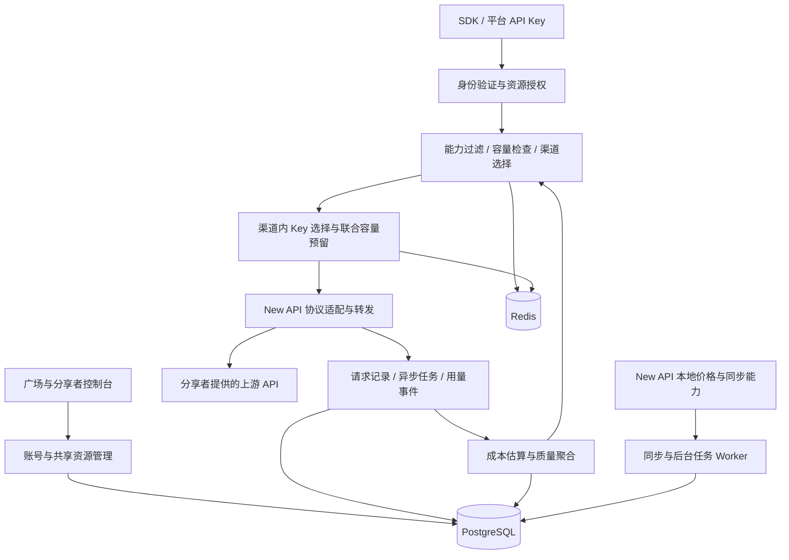

# APIGX：AI API 资源共享平台计划书

版本：v1.0 · 2026-09-16  
状态：完成方案复核，可进入阶段 0 开发；尚未开始业务实现及运行验证。  
项目目录：`D:\Github\apigx`

本版保留全部已确认需求，并补齐授权优先级、资源生命周期、容量故障处理及分阶段交付约束。第 12 节给出可直接采用的开发默认值；首批真实上游凭据和部署信息在对应验收前补充，不阻塞开始开发。

## 1. 项目定位与已确定方向

APIGX 是一个让用户分享 AI API 资源、发现模型并统一调用的社区平台。分享者提供自己有权分享的上游 API，平台保管凭据、统一接入并记录消耗；使用者领取平台 API Key，通过同一个入口调用不同分享者提供的模型。

模型广场按标准模型聚合展示。同一个模型可以由多个分享者提供，使用者既可以指定某个分享渠道，也可以按延迟、吞吐、最近 6 小时可靠性或综合策略自动选择。

### 已经确认的产品决策

| 项目 | 确定内容 |
|---|---|
| 费用模式 | 免费共享，记录用量和估算成本 |
| 资源范围 | AI 类 API：对话、图片、语音、向量、重排、视频 |
| 访问范围 | 支持公开、邀请码或指定用户、仅自己可用 |
| 分享组织 | 分享者可以创建并命名自己的分组 |
| 多 Key 分享 | 同一渠道可添加多把上游 Key，支持轮询等选择方式，并分别管理状态、限额与消耗 |
| 模型发现 | 能发现的接口支持一键获取；不支持发现的接口允许手工添加 |
| 价格来源 | 一键匹配只读 New API 当前本地价格配置，支持人工填写和覆盖，不另接外部价格源 |
| 默认币种 | USD（美元），用于默认价格输入、展示、估算成本和预算；保留来源原币种 |
| 使用方式 | 指定渠道、延迟优先、吞吐优先、6 小时可靠性优先、综合自动 |
| 调度约束 | 所有策略结合渠道并发、RPM/TPM、任务容量和资源预算，不能突破配置上限 |
| 底座 | 优先基于 New API 改造，接受开源及相应许可义务 |

### 第一版的边界

- 第一版完整目标包含上述六类 AI 能力；按阶段交付，先完成对话闭环，再补齐其他类型。
- 免费表示平台不向使用者收费。分享者自己的上游账户仍可能产生真实费用，因此必须有资源额度、限流和暂停能力。
- 不引入充值、交易、收入分成、提现或积分兑换；“估算成本”不构成应付账单。
- 不扩展天气、支付等任意 HTTP API。以后有需求时再设计通用服务目录。
- “支持某种协议”按具体端点和功能验收，不承诺所有厂商、所有字段无损互通。

## 2. 核心概念：四类对象分别管理

| 对象 | 含义 | 示例 |
|---|---|---|
| 分享分组 | 分享者自定义的资源集合，有名称、说明及默认访问策略 | 小林的公益模型站 |
| 渠道 | 实际连接某个上游的配置，包含协议、地址、一个或多个凭据、额度和状态 | 小林的主线路 |
| 标准模型 | 广场聚合使用的模型身份，包括厂商、型号、版本等 | `vendor/model-x-202609` |
| 模型供给 | 某条渠道提供某个标准模型的记录，关联上游模型 ID、能力、价格和质量 | 小林主线路提供 Model X |

第一版采用一个渠道属于一个分享分组；一个分组可以包含多个渠道，一个渠道可以提供多个模型。模型广场以标准模型为中心，把不同分组里的模型供给聚合起来。

每条渠道内部可以维护一个上游 Key 池。Key 属于该渠道的分享者，使用者看到的是模型和分享渠道，不会取得上游密钥。平台 API Key 用于使用者接入平台，与分享者的上游 Key 分开管理。

三个边界需要保持清楚：

1. **分享分组不等于 New API 的用户分组。** 后者涉及现有渠道可用范围和倍率，不能直接当作分享者的文件夹。
2. **名称不作为授权依据。** 分享分组可以重名，调用和授权始终使用稳定 ID，界面同时显示分享者身份。
3. **同名不一定是同一模型。** 厂商、版本、微调版本、量化变体等不明确时进入待确认队列，避免错误合并。

### 聚合展示示例

```text
模型广场
└─ Model X · vendor/model-x-202609
   ├─ 小林 / 公益模型站 / 主线路
   ├─ 阿青 / 实验室资源 / 备用线路
   └─ 小周 / 我的私有模型 / 自用线路（仅小周可见）
```

模型卡片上的渠道数量、可用性和详情列表，都按当前访问者的权限计算。私有或受限资源不会通过搜索结果、计数、公开指标或 `/v1/models` 泄露。

“可以看见”和“当前可调用”分别计算：公开但暂停的供给可以显示不可用状态；受限供给仅其所有者和获授权用户可见；私有供给仅所有者可见。访客只能看公开介绍，实际调用要求已登录用户的平台 Key。邀请码兑换页在兑换成功前不暴露受限资源详情。

## 3. 用户角色与主要流程

### 3.1 用户角色

| 角色 | 能力 |
|---|---|
| 访客 | 浏览允许公开的模型介绍；默认不能调用 |
| 注册用户 | 创建平台 API Key，使用授权资源，查看自己的用量 |
| 分享者 | 普通用户提交资源后即可拥有此身份；管理自己的分组、渠道、邀请与消耗 |
| 管理员 | 配置注册政策、审核资源、维护模型映射、处理举报和封禁 |

分享者保持普通用户权限，不通过授予管理员身份实现渠道管理。

### 3.2 分享者发布流程

1. 创建分享分组，填写分享名称和简介。
2. 选择上游协议或厂商适配器，填写 Base URL，添加一把或批量导入多把 API Key，设置 Key 池策略。
3. 执行“一键获取模型”：读取上游目录、处理分页、生成待导入列表。
4. 勾选要分享的模型，确认标准模型映射；可以手工添加、编辑上游模型 ID。
5. 执行“一键拉取/匹配价格”：读取 New API 已同步的本地定价与计价表达式；默认显示美元，允许批量确认与逐项人工覆盖。
6. 设置访问范围、资源额度、并发上限、RPM/TPM、异步运行任务上限和到期时间；共享同一上游账户额度的渠道归入同一限额池。
7. 按当前审核政策发布。模型供给进入对应模型详情页。

获取模型目录成功只证明目录可读取，不代表其中每个模型都可调用。需要另设可选的连通性测试；可能产生费用的主动探测必须受分享者配置的探测预算控制。

重新同步显示新增、变更和消失项。新增模型先进入待发布状态，不自动扩大分享范围；消失项标为待核查或暂停，保留历史统计。

### 3.3 使用者调用流程

1. 在广场按模型名、厂商、能力、可用性或分享者筛选。
2. 打开模型详情，查看能力说明和各个分享来源。
3. 选择某条供给，或选择自动路由策略。
4. 创建平台 API Key，复制适合当前模型的调用示例。
5. 使用现有 SDK 调用统一入口；在用量页查看实际渠道、耗时、用量和估算成本。

推荐把默认模型、允许模型、默认路由策略和可用分享范围保存到平台 Key。大多数用户只需修改 SDK 的 Base URL 和 API Key。

### 3.4 分享者查看消耗

支持按时间、分享分组、渠道、模型聚合查看：请求数、成功率、token 或其他计量单位、估算成本、剩余额度和异常原因。

多 Key 渠道还支持按 Key 的脱敏名称/内部 ID 查看请求数、成功率、限流次数、用量和 USD 估算成本。消耗记录绑定实际执行的 Key；渠道汇总来自这些记录，不因更名、轮换或移除 Key 丢失历史。

默认提供汇总及脱敏调用标识，不向分享者展示其他使用者的邮箱、平台 Key、提示词或生成内容。排查问题可使用请求 ID；滥用调查由管理员按权限处理。

### 3.5 多 Key 分享与管理

同一协议、同一 Base URL 的多把 Key 可以放在同一个渠道内，支持逐条添加或批量粘贴导入。不同地址或协议使用不同渠道，再由同一分享分组组织。

分享者可为每把 Key 设置名称、启停状态、权重、并发/RPM/TPM、预算或用量上限、到期时间及所属上游账户限额池。凭据按条加密保存，导入时检测重复，保存后只显示脱敏信息。轮询索引和历史统计使用稳定 Key ID，不依赖批量输入的行号。

| Key 池策略 | 行为 |
|---|---|
| 轮询（默认） | 在符合模型能力、状态和容量要求的 Key 中依次选择；自动跳过禁用、满载、到期或冷却的 Key |
| 随机 | 在当前合格 Key 中随机选择 |
| 加权分配 | 按分享者设置的权重分配，适合容量不同的 Key；权重不能突破硬限额 |
| 剩余容量优先 | 优先选择占用率较低、有足够剩余额度的 Key |

New API 已有多 Key 的启停、随机和轮询基础，可复用其配置及选择逻辑；按 Key 的请求生命周期限额、共享账户约束及新增策略需要扩展，不能把原生轮询的互斥锁当作并发上限实现。[N4j]

Key 权限不同的情况下，发现和验证结果保留到 Key 层。某把 Key 列出了一个模型，不代表同渠道其他 Key 都有权限；执行时只选已声明或验证支持所需模型和能力的 Key。未验证状态明确显示，不能仅用第一把 Key 的发现结果给整个池确认可用。

同一渠道的 Key 可以继承统一价格配置；若对应上游分组、折扣或计费档位不同，须分别关联确认后的价格配置，在确定实际 Key 后绑定价格快照及预留预算。界面显示价格范围或差异，不能用最便宜 Key 的价格代表所有调用。

Key 的模型能力、限额和价格差异影响调度，但不会在模型广场制造重复的模型卡片，也不会公开 Key 名称或内部 ID。

## 4. 功能范围与页面安排

### 第一版必须具备的能力

| 模块 | 范围 |
|---|---|
| 账号 | 注册、登录、邮箱验证、密码重置、邀请码、注册开关 |
| 分享管理 | 分组命名、渠道 CRUD、多 Key 导入及轮询策略、独立启停与轮换、模型发现、暂停与恢复 |
| 访问控制 | 公开、邀请兑换、指定用户、仅自己；访问撤销与到期 |
| 模型目录 | 标准模型、别名、版本、能力说明、模型聚合广场、详情页 |
| 价格 | 复用 New API 同步，批量匹配、人工覆盖、USD 归一、版本与未知价格状态 |
| 调用网关 | 多协议、多类型 API、平台 Key、指定来源、自动路由、流式响应 |
| 质量统计 | 渠道与模型维度的延迟、吞吐、最近 6 小时可靠性、样本数 |
| 消耗管理 | 使用者和分享者视角的统计、额度、限流、预算与告警 |
| 运维管理 | 审核、禁用、模型映射管理、注册配置、脱敏审计 |
| 开发者体验 | 按协议生成示例、请求 ID、清晰的错误码和可用模型列表 |

### 页面结构

- **模型广场**：搜索、类型筛选、模型卡片、可访问来源数和质量摘要。
- **模型详情**：模型介绍、能力与协议、分享来源表、价格与质量对比、调用配置。
- **分享分组页**：分享者、分享名称、介绍、当前用户有权看见的资源；资源邀请通过独立兑换入口处理。
- **我的分享**：分组和渠道、Key 池策略及单 Key 消耗、同步模型、匹配价格、访问授权、额度与状态。
- **我的用量**：按请求和模型查看个人消耗、估算成本及路由结果。
- **我的 API Key**：创建、撤销、到期、允许模型、来源限制与路由策略。
- **任务中心**：图片或视频等异步任务的状态、结果和保留期限。
- **管理后台**：注册政策、资源审核、用户与渠道治理、模型映射、系统状态。

第一版可以提供轻量测试面板，不把完整聊天产品作为网关上线的前置条件。

## 5. 开源选型与复用策略

### 5.1 推荐结论

**以 New API 为主底座，进行模块化改造。** 它与中文社区模型中转平台的账号、渠道和用量工作流较接近。新增开发集中在多用户分享、资源权限、模型聚合、价格映射与质量路由。

本次核查基于 New API `main` 提交 `69a50029819a26c53e6babd276d49cfe2f8880ad` 的官方资料和部分源码；阶段 0 固定开发提交，部署前锁定经过验证的稳定版本及镜像摘要，不能直接把移动的 `main` 当作生产版本。[N1–N3、N4a–N4j]

| 方案 | 可利用之处 | 对本项目的主要缺口 | 决策 |
|---|---|---|---|
| New API | 多厂商适配、渠道管理、账号及令牌、用量与转发基础 | 分享者隔离、资源 ACL、广场聚合、普通用户指定来源、渠道质量路由 | 主路线 |
| LiteLLM | AI 多端点适配、虚拟 Key、成本追踪、重试及多种路由策略 | 社区分享工作流与广场仍需建设；部分企业功能单独许可 | 保留作备选及实现参考 |
| APISIX / Kong | 通用 API 鉴权、限流、代理、负载均衡和扩展机制 | 模型共享目录、价格映射与社区管理需额外开发 | 当前不再额外部署一套网关 |
| 从零实现 | 所有行为可自定义 | 要重复处理协议差异、流式响应、计量与重试，维护面更大 | 不采用 |

LiteLLM 的非企业目录采用 MIT，`enterprise/` 另有许可；不能将全部功能视为 MIT。Kong 和 APISIX 的开源仓库采用 Apache 2.0，但厂商商业产品的能力不能据此推定为免费可用。[L1–L3、G1–G2]

### 5.2 New API 的复用边界

| 部分 | 处理方式 |
|---|---|
| 厂商适配器、请求构造、响应转换 | 尽量直接复用；逐端点核验目标协议和功能 |
| 流式输出、超时、错误处理 | 复用执行基础，并补充安全重试与完整流统计 |
| 账号、平台令牌、邮箱验证 | 复用基础；新增注册邀请政策和资源访问授权 |
| 管理员渠道 CRUD、模型获取 | 复用内部逻辑和 `fetch_models` 发现器；新增受 owner 约束的分享者接口 |
| 多 Key 管理 | 复用启停、随机/轮询基础；补稳定凭据 ID、逐 Key 能力及消耗、容量占用和共享限额 |
| 模型映射及现有价格功能 | 读取 New API 已生效的按次价、倍率价和计价表达式；补服务端候选确认与渠道价格版本，不新增外部源适配器 |
| 消耗日志 | 复用采集基础；新增分享者归属、多计量单位和价格快照 |
| 现有渠道调度 | 保留执行基础，扩展为一个权威的共享资源路由器 |
| 前端 | 保留可用表单与后台组件，重做分享广场及分享者工作流 |

源码核查发现，现有渠道管理受 `AdminAuth` 保护，渠道模型没有本项目需要的 `owner_user_id`；普通用户直接指定渠道存在管理员权限限制。因此不能仅开放现有管理页面，也不能让浏览器持有管理员凭据。[N4a–N4b]

现有模型广场及性能统计可以复用展示和采集基础，其聚合键包含模型、用户分组与时间桶，但不等同于本项目需要的“某个分享渠道提供某个模型”的统计，需要扩展渠道维度。[N4c]

### 必须明确修改的底座行为

1. **来源选择授权**：原有指定渠道分支与普通选路的 token 模型限制检查不是同一条路径。不能只删除管理员判断；指定、自动、亲和缓存、重试和任务原渠道锁定都必须经过同一资源授权检查。[N4b]
2. **邀请准入**：原有 `aff_code` 用于推广归因，不等于必须提交有效邀请码才能注册。新增真正的注册邀请策略及原子核销，不复用其名称就宣称功能完成。[N4d]
3. **免费计量**：新增明确的 `usage_only` 模式，覆盖同步、流式、异步及失败处理；不执行钱包或订阅扣费，仍记录正参考价格、用量和资源额度。[N4e]
4. **任务产物权限**：原生任务查询已有用户归属，但部分产物下载允许长期签名链接。私有资源不能只保护查询接口；下载默认校验任务所有者，确需临时链接时增加短有效期、撤销机制及明确的传播范围。[N4f]

### 5.3 开源与升级维护

用户已接受开源方向。采用修改版 New API 时保留 AGPLv3、版权与 NOTICE，按许可向通过网络使用修改版的用户提供对应源码获取方式；保留要求的可见署名及原项目链接，标注修改。[N2–N3]

新代码按目录和模块组织，新增共享领域表，避免将分享分组塞进现有用户分组字段。维护少量明确的转发、授权、路由及计量扩展点，记录相对上游的改动；升级时检查这些扩展点和数据库迁移。

## 6. 推荐架构

第一版采用模块化单体，沿用 New API 的 Go 后端和 React 前端。数据库优先 PostgreSQL；Redis 用于限流、并发额度、短期质量数据与缓存。异步任务由同仓库 Worker 处理，部署时可与 Web 进程分开运行。无需先引入 Kubernetes、多层微服务或独立大数据平台。



### 架构约束

- **一次请求只有一个权威路由决定。** 共享路由选中供给后，转发器不能再随机选择其他渠道；允许的重试也须回到同一授权与路由逻辑。
- **实际 Key 同样由该调度流程决定。** 转发器接收确定的渠道和凭据引用，不能在原生 `GetNextEnabledKey` 中再次抽选。否则已预留的额度、价格快照与实际使用 Key 会不一致。
- **服务端负责隔离。** 所有分享管理接口按登录用户校验归属；新调用按平台 Key 和当前资源 ACL 校验权限，已有对象操作按第 10.3 节的用户所有权及生命周期规则校验。
- **凭据只维护一份权威记录。** 分享控制台写入受保护的凭据存储，转发时按权限读取；不在新旧业务表里复制明文 Key。
- **计量事件可以可靠补处理。** 使用请求 ID、尝试 ID、任务 ID 和幂等聚合，避免断连、重试或 Worker 重启造成重复统计。
- **Redis 不是历史账本。** 用量及价格快照落持久存储；共享额度无法安全判断时，默认停止新增调用并返回明确错误。
- **指标和价格外部同步不阻塞调用。** 使用已校验缓存，标注数据新鲜度，失败不清空既有数据。

免费模式应显式修改原有余额检查和结算调用路径：保持鉴权、额度与计量，取消用户充值余额前置条件。不能通过把模型价格统一设为零或给所有用户超大余额来替代，否则会破坏估算成本或资源控制。既有免费模型分支是否适合复用，以完整生命周期验证结果决定，不仅检查请求开始时的余额判断。

## 7. 核心数据模型

| 实体 | 关键内容 |
|---|---|
| User / APIKey | 用户身份、Key 哈希、可访问范围、默认策略、额度及到期时间 |
| ShareGroup | 分享者、分组名称、简介、默认策略、发布状态 |
| Channel | owner、分组、协议、Base URL、Key 池策略、并发/RPM/TPM/任务上限、共享限额池、健康状态 |
| UpstreamKey | 渠道、稳定 ID、名称、secret_ref 与凭据版本、启停/冷却/到期、权重、独立限额、上游账户池及价格配置 |
| KeyModelCapability | Key 支持的上游模型和能力、发现/验证状态及时间 |
| CanonicalModel | 厂商、标准 ID、版本、类型、能力和描述来源 |
| ModelAlias | 上游或外部价格 ID 到标准模型的映射、范围和确认状态 |
| ModelOffering | 标准模型与渠道的关联、上游 ID、实际能力、访问策略、价格版本 |
| AccessPolicy / Grant | 公开、私有或受限策略，用户授权、来源、到期和撤销状态 |
| Invite | 注册邀请或资源邀请、Token 哈希、使用次数、有效期与目标范围 |
| PriceSnapshot / PriceRule | 来源、原始记录、原币种、USD 价格、汇率快照、单位、倍率口径、条件、人工覆盖、生效时间 |
| CapacityPolicy / Reservation | 限制维度、配置版本、并发或运行任务租约、RPM/TPM 与预算预留、归还和过期状态 |
| Request / Attempt | 一次用户请求与每次上游尝试，渠道和 Key 策略、实际渠道及 Key ID、结果及耗时 |
| UsageEvent | 分项用量、可信度、成本估算状态、价格快照与归属 |
| QualityBucket | 供给、能力、地区或部署点、时间桶、样本量、延迟及吞吐分布 |
| AsyncTask | 平台任务 ID、上游任务 ID、用户、原渠道与 Key/凭据版本、分享者与权限版本快照、价格版本、状态、结果引用 |
| UpstreamObjectRef | 用户、平台对象 ID、上游对象 ID、对象类型、原渠道/Key/账户、访问期限；用于文件、会话、缓存和任务产物 |
| AuditEvent | 分享配置、权限、价格、凭据轮换与管理员操作的脱敏记录 |

关键关联：`User → ShareGroup → Channel → ModelOffering → CanonicalModel`；同时 `Channel → UpstreamKey → KeyModelCapability` 描述实际可执行的 Key。

访问策略可在分组设默认值、在供给层进一步收紧。最终权限取账号状态、平台 Key 范围、分组与供给当前访问权限的交集，再执行额度约束；所有者可管理自己的资源，但调用同样计量和限额。资源邀请兑换和指定用户都生成受资源范围约束的 Grant；邀请到期影响后续兑换，已生成 Grant 有独立到期时间，撤销邀请可明确选择是否同时撤销由它产生的 Grant。

单供给邀请仅授予目标供给及展示其所属分组所必需的信息，不授予同组其他供给。受限分组可按目标范围签发邀请，私有分组不允许通过子供给邀请对外开放；必须由分享者显式变更父级策略后再分享。

模型合并、别名调整和分享分组更名不改变已有授权或历史请求归属。标准模型由平台维护，分享者可以提交映射建议、选择明确命中的模型或发布自定义模型，不能编辑全局标准模型或其他人的映射。

分组、供给和 Key 的退役使用软删除，保留被请求、任务、价格及计量记录引用的稳定 ID；数据保留期届满后再按保留规则清理。展示名、价格或 owner 变化不回写历史快照。后续若要转移资源所有权，需另设迁移流程，第一版不开放直接修改 owner 的接口。

## 8. 模型发现、身份归一与价格匹配

### 8.1 一键获取模型

根据适配器调用对应的模型目录接口。例如 OpenAI 兼容目录和其他厂商的原生目录分别解析，处理分页、认证差异及模型能力字段。

无法发现、返回不完整目录、需要额外权限或根本没有目录 API 的上游，使用手工输入或批量粘贴；明确显示原因，不将获取失败解释为“该渠道没有模型”。

上游提供的模型名、描述和 URL 都属于不可信输入。目录返回同名模型也不构成模型真实性认证；广场分别标注“分享者声明”“目录发现”“连通性验证”等证据状态。

### 8.2 标准模型归一规则

按以下顺序执行：

1. 厂商、标准 ID、版本及必要变体完全匹配。
2. 命中经过确认且适用于当前厂商或渠道的别名映射。
3. 相似名称仅提供候选，让分享者选择，必要时交管理员确认。
4. 无法确认的模型仍可作为自定义模型发布，但暂不并入已有标准模型。

不通过删除版本号、日期或量化后缀来强行归并。动态 `latest` 别名需标注；未经确认的“自称同模型”供给不能参与严格同版本的自动路由。

每个标准模型具有稳定的内部 ID 和对外 `api_model_id`，客户端从可用目录及调用示例获取该值；转发器再转换为所选供给的上游模型 ID。兼容别名只在唯一、明确命中时解析，歧义时返回错误而非任意选择。模型归一确认是目录映射证据，不等于已验证上游运行的模型权重或身份。

同一模型支持的工具调用、视觉输入、上下文长度、JSON 格式、音色和视频规格可能因渠道而异，记录在供给层。自动路由先按请求能力过滤。

### 8.3 价格来源：只读 New API 当前本地配置

价格匹配只读取 New API 当前已生效的本地按次价、倍率价与计价表达式。APIGX 不调用外部公开价格库，也不直接执行 New API 的上游价格抓取，避免重复解析、缓存和来源优先级。

**APIGX 的唯一自动候选来源是 New API 本地价格配置。** 管理员仍可在 New API 原生后台维护或同步全站价格；APIGX 只消费维护后的本地结果，补上分享者权限、渠道级不可变版本和来源标记。人工价格继续作为显式覆盖。[N4g]

#### New API 现成功能与改造边界

在本次核查的固定版本中，APIGX 读取以下本地结果：[N4g–N4i]

| 本地配置 | APIGX 读取方式 |
|---|---|
| `model_price` | 转为 USD/次的请求次数价格 |
| `model_ratio`、`completion_ratio`、缓存倍率 | 按运行时 `QuotaPerUnit` 转为 USD/百万 token 的分项价格 |
| `billing_setting` 计价表达式 | 仅在可无损展开时生成候选；动态或条件表达式要求人工输入 |

New API 原生后台仍可通过 `GET /api/ratio_sync/channels`、`POST /api/ratio_sync/fetch` 与 `PATCH /api/option/model_pricing` 维护全站本地配置。该流程属于底座管理员能力；APIGX 的分享者一键匹配不调用这些外部读取步骤，也不向其写价。[N4g–N4i]

**需要改变保存目标。** 原生保存按 `model_name` 修改全站 Option 中的模型价格，没有分享渠道 ID。本项目将分享者同步结果保存到其有权管理的模型供给及必要的 Key 价格配置，生成不可变价格版本；普通分享者不能借同步接口修改全站模型价格。

原生旧倍率按 `$0.002 / 1K tokens = 1 ratio` 解释，已具备美元展示换算。复用时将其转为绝对单价：[N4h]

| 旧字段 | 对应的标准价格 |
|---|---|
| `model_ratio = r` | 输入 `2 × r` USD / 1M tokens |
| `completion_ratio = c` | 输出 `2 × r × c` USD / 1M tokens |
| 缓存读取/写入倍率 | 输入单价乘对应倍率 |
| `image_ratio` | 图片输入 token 单价的倍率，不能直接当作每张图片价格 |
| `audio_ratio`、`audio_completion_ratio` | 音频输入为基础输入价乘音频倍率；音频输出再乘音频输出倍率 |
| `model_price = p` | 基础 `p` USD/次；具体尺寸、数量和任务参数等仍需按适配器规则处理 |

平台内部采用“币种 + 计量单位 + 绝对单价”的标准格式，倍率只作为兼容导入格式。这样能够表示输入免费但输出收费等旧倍率不易表达的情况；内部额度单位也不能直接展示成美元金额。

需要保留的限制：

- `/api/pricing` 的原生价格列表解析不等于导入分享者 Key 的实际组倍率，展示价尚未应用分组或充值调整。成本倍率必须对应实际 Key 的适用身份；特殊用户组倍率与普通组倍率若为替代关系，不重复相乘，也不套用 APIGX 自己的用户组倍率。
- 底座管理员从何处维护本地价格不改变 APIGX 的信任边界；APIGX 只记录最终本地配置的来源标记和不可变快照。
- 同名模型仍先精确匹配，再使用已确认别名；不会因为外部供应商名称相似而自动归并。

#### 模眼调研归档（不接入运行时）

2026-09-16 已读取 `llms.txt`、帮助文档及全部四页官方价格 Markdown：[P5–P7]

- `https://okmoyan.com/llms.txt` 是导航和数据边界说明，不是价格 JSON 本身。
- 实际公开价格入口是 `https://okmoyan.com/prices/index.md`，支持 `?page=N` 分页；本次读取 100 + 100 + 100 + 68，共 368 条记录，不能只抓第一页。
- 本次四页记录均标记为 USD、`per_1m_tokens`，包含模型 ID、厂商、部分厂商变体、输入/输出与缓存价格、来源链接及同步时间。Markdown 中的下划线可能经过转义，需要正确解析。
- 同一模型 ID 可能有不同厂商入口或地区变体，不能仅以模型 ID 去重后覆盖价格。
- 站点明确：公开 Markdown 不包含供应商价格、分组倍率和账号可见折扣。这里的参考价格不代表具体渠道实付成本。
- 本次核实的是公开 Markdown 数据契约，没有据此假定另有稳定的公开价格 JSON API；该调研不形成适配器或运行时依赖。
- 本次记录的单位覆盖不代表完整覆盖按秒视频、按张图片等规则；APIGX 不导入这些值，New API 本地缺失的维度由人工填写。

#### ModelRadar 调研归档（不接入运行时）

2026-09-16 已读取其 API 文档、Schema 和实际 JSON：[P1–P4]

- `GET https://modelradar.cn/data/models.json`：公开、无需 API Key，返回全量静态数据。
- `GET https://modelradar.cn/data/changelog.json`：变更摘要和历史索引。
- 文档提供按日期查询历史完整快照的路径。
- 本次实际读取 `schemaVersion = 1`，`effectiveDate = 2026-09-16`，共 317 条记录；这只是当日数据规模。
- 具备输入、输出、缓存读写价格，以及 `currency`、`sourceUrl`、`sourceType`、`updatedAt` 等字段。
- 全局基准是 USD / 每百万 token，同时部分记录有原始币种价格字段。
- 文档允许字段为 `null`，并区分抓取来源 `provider` 和预置来源 `fallback`；即使标记为 `provider` 也不等于本平台已独立核实价格。

**实际数据存在单位和规格处理边界。** 本次读取的部分视频条目在 token 价格字段为 `null`，按秒价格写在 `pricingNotes`；部分音频记录的数值字段与备注中的计费单位也需要交叉确认。部分记录还包含 Standard、Batch 等价格类别。因此不能仅按相同字符串 ID 命中后，就直接把数值用于估算。

### 8.4 匹配与更新策略

1. 一键匹配只读取 New API 本地的按次价、倍率价和计价表达式，模型 ID 先精确匹配，再使用已确认别名。
2. 动态或条件表达式无法无损展开时标记为需人工输入，不用样例请求价冒充完整规则。
3. 浏览器只提交服务端候选令牌；确认时服务端重新读取当前价格，候选变化即要求重新预览。
4. 确认结果只写入当前分享者渠道的供给价格版本，不能修改 New API 全站定价或其他分享者数据。
5. 人工覆盖优先且锁定；没有有效价格的模型显示“未定价”，不能写成零价。

“价格未知”和“价格为零”分别存储。未知费用不累计成零；页面同时展示可估算总额、未估算请求数与覆盖率。

带身份的上游价格和模型发现缓存必须包含分享者、渠道、凭据/上游分组范围及配置版本，不能仅按域名或模型 ID 共用。保存时再次检查所有权和候选令牌，期间价格、倍率或 Key 配置发生变化则重新预览，避免将旧确认覆盖新配置。

### 8.5 成本估算体系

| 类型 | 支持的计量规则 |
|---|---|
| 对话、向量 | 输入和输出 token；按提供者语义处理缓存读写及额外维度 |
| 图片 | 按张、分辨率、质量档位，或厂商规定的图像 token |
| 语音识别 | 输入音频秒数或分钟数 |
| 语音生成 | 字符、音频 token、输出秒数等厂商规则 |
| 重排 | 请求、文档数量或 token，取决于上游 |
| 视频 | 输出秒数、分辨率、质量、是否带音频等条件 |

估算基础为“各个不重叠计量分项的用量 × 对应单价之和”。缓存 token 是否包含在输入总量中由适配器归一，避免重复计算。使用定点小数或整数最小计量单位，价格快照绑定请求或任务。

至少区分两类估算：按照外部参考价格计算的参考成本，以及按照分享者填写价格计算的渠道成本。渠道实际采购折扣、赠送额度和上游账单不在平台可确定范围内；界面明确标注价格口径。

**默认采用美元。** 价格表单、模型详情、估算成本、预算和统计汇总默认使用 USD；token 价格默认以 `USD / 1M tokens` 表示，图片/音频/视频继续保留每张、每秒或每分钟等实际计量单位。USD 是币种选择，不意味着将所有模态都改成 token 计价。

来源已是 USD 时直接使用，不能重复换算；来源为 CNY 等币种时，保存原始金额和币种，使用明确方向的汇率换算成 USD，例如 `USD金额 = CNY金额 ÷ 每美元对应的人民币数`。汇率必须保存来源、生效时间及版本，不能将某个固定汇率写死为永久规则。

每笔历史估算绑定当时的价格和汇率快照；以后更新汇率不改写历史。缺少有效汇率时保留原币种金额，USD 金额标为待换算并计入未估算数量，不能当作 0 USD 汇总。仍保持免费共享，仅统计参考或渠道估算成本。

上游未返回准确用量时，记录本地估算或未知状态，不伪装为实际计量。

计数与成本采用以下固定口径：一次用户调用对应一个 Request，每次实际上游执行对应一个 Attempt。用户请求数按 Request 计，上游请求数按 Attempt 计；渠道/Key 的消耗累加所有已知尝试用量，失败和重试也可能有成本。按请求数计价时以该上游的实际计费单位为准，不能把多次尝试都压成一次。

流式请求的中间 usage 与最终累计 usage 由适配器区分，不能相加造成双计。异步任务提交、轮询和终态只能形成一份任务用量结算，额外收费的查询操作另记。重复事件按稳定事件 ID 幂等处理；后续补到准确 usage 时追加校正事件，保留原估算和修订轨迹，不覆盖历史证据或重复扣预算。

开发期汇率采用管理员维护的版本化配置，记录汇率依据及生效时间；不增加未经选择的第三方汇率依赖。数据库时间戳统一 UTC；日限额默认按 Asia/Shanghai 划分，保存配置版本和请求准入日，跨日完成的结算回到原预留周期。统计界面明确日期范围与时区。

## 9. 指定来源与自动路由

### 9.1 统一入口与调用选择

复用适配器支持的客户端协议，优先提供 OpenAI 兼容入口，同时按实际能力开放 Anthropic、Gemini 等原生入口。图片、音频、向量、重排和视频保留各自请求语义，不强行包装成聊天消息。

下面是拟议的扩展请求头，属于 APIGX 设计，不是 New API 已有接口承诺：

```http
Authorization: Bearer <platform-api-key>
X-APIGX-Offering: <offering-id>
```

或选择策略：

```http
X-APIGX-Route: latency | throughput | reliability | auto
```

同一次请求显式提交指定供给与自动策略时返回参数冲突。无法增加自定义请求头的客户端可使用保存了来源或策略的平台 Key。配置分为**硬限制**和**默认偏好**：允许模型、允许来源、固定来源、是否允许回退是硬限制；默认路由模式是偏好。有效选择顺序是先执行硬限制，再采用合法的请求参数，否则使用 Key 默认偏好，最后使用系统默认 `auto`。

“固定来源 Key”只能调用固定来源，请求头不能解除绑定或扩大授权；需要回退的 Key 必须在其允许来源集合中明确授权回退。请求参数只能选择 Key 已允许的资源。所有客户端协议、原生指定渠道入口、亲和缓存和重试都执行同一约束，不能留下管理员后缀等旁路。平台扩展头在出站前剥离，上游不会收到平台 Key 或内部授权信息。

指定来源时，该来源不可用便返回原因，默认不悄悄改用其他分享者。用户可明确开启“指定来源失败后允许自动回退”，回退仍限于其授权和信任范围。

未授权或不存在的供给对外统一返回不可访问的 `404`，避免枚举私有来源；凭据无效返回 `401`，参数冲突返回 `400`，暂时容量不足返回 `429`，授权范围内没有健康可用渠道返回 `503`。返回脱敏请求 ID，容量错误在可计算时附 `Retry-After`；内部日志保留精确归因，外部错误不输出上游 Key、地址细节或其他用户信息。

文件、会话、缓存和异步任务只接受属于当前用户的平台代理对象引用。上传/创建、查询、取消、下载和后续请求引用都校验对象归属并定位原渠道与账户；猜到上游 ID 不能跨用户访问。第一版不开放未经这些检查覆盖的透传管理端点。

### 9.2 先过滤，再排序

每次请求先筛选：用户和平台 Key 权限 → 可见供给 → 同一标准模型及版本 → 协议和功能兼容 → 用户允许的分享者与隐私范围 → 健康状态 → 渠道及上游 Key 池的可用性 → 渠道/Key/共享限额池的实时容量 → 价格或预算约束；在合格渠道中排序，再按池策略选择合格 Key，原子占用所需容量，成功后才向上游发送。

只在满足上述条件的候选里评分。质量再高也不能绕过权限、改换模型、超出用户指定来源或跨越用户的分享者限制。

#### 渠道配置直接参与智能路由

| 渠道配置 | 路由及执行行为 |
|---|---|
| 最大并发请求数 | 达到上限就退出新请求候选；所有实例共享占用数，不能各自单独计算 |
| 单 Key 的独立限制 | Key 满载、到期、失效或冷却时跳过；整个池没有合格 Key 时，渠道不能接收新请求 |
| RPM / TPM | 按配置窗口限制请求数和 token；校验请求实际大小及输出上限，预留后按实际用量调整 |
| 最大运行中异步任务数 | 视频等任务提交成功后持续占用，直到终态或经过确认的取消；不能 HTTP 提交响应结束就释放 |
| 每日用量、USD 估算预算 | 可预估时先预留；不足则不可选，未知用量仍执行独立数量和规格上限 |
| 请求/输出/媒体规格上限 | 超出单次输入、最大输出、图片尺寸、音频或视频时长限制时排除该供给 |
| 同一上游账户的共享限额 | 多模型、多 Key、多渠道共用的额度按共享池约束，不能重复申报容量 |
| 优先级、权重、排队设置 | 只作用于已满足硬限制的候选，并遵守调用者选定策略；分享者自设优先级不能抢占其他分享者的质量排序 |
| 暂停、有效期、冷却及配置修改 | 调度实时读取生效版本；下调并发后停止新增，已有请求按既定策略结束 |

“未配置”“禁用”“继承平台默认值”和“明确不限”分别表达，不把空字段自动解释成无限容量。具体 UI 可以简化，但后台含义必须明确。

平台控制的是经由本平台的请求及已配置的共享限额池。分享者在平台外的使用量、不同用户暗中共享同一上游账户等，无法仅凭 Key 自动推断；由分享者声明关联、可用的上游额度接口及限流反馈修正可用容量，不能承诺上游账户在所有系统中的总消耗都受本平台约束。

质量评分使用**剩余容量和当前占用率**。例如渠道 A 首字更快，但已占满 4/4 并发，自动路由必须选择有余量的授权渠道 B；A 为 3/4 时可结合排队风险与 B 的质量比较。吞吐优先也不能把所有流量分给单次生成速度最快但容量很小的渠道。

容量控制需要处理这些执行细节：

1. 对相关用户、平台 Key、渠道、实际上游 Key、模型供给和上游共享池原子预留；任一维度失败就撤销本次未生效预留，重新选合格 Key 或渠道。仅“先读计数再发送”会在并发下突破上限。
2. 同步与流式调用持有请求槽位到实际结束。用唯一尝试 ID 保证归还幂等；长流使用续租，进程异常后通过到期、任务状态和补偿对账恢复，不能简单提前放行仍在上游运行的请求。
3. HTTP 请求并发与异步任务并发分别记账；轮询查询也遵守适用的速率限制，但不重复增加生成任务槽位。
4. 重试必须为目标渠道重新获取容量；已发往上游的请求次数或已消耗 token 不因请求失败就全部退回。结果未知时保留待核实的消耗和任务状态。
5. 全部候选暂时满载时，默认返回容量不足的 `429`；可配置有上限的短等待和公平排队。指定来源满载时同样执行限制，不因指定而强行突破，也不未经授权切换来源。
6. 排队、准入拒绝与上游失败分别统计；等待时间计入用户总耗时，不能靠无限排队改善表面的渠道成功率。

第一版采用单逻辑 Redis 主存储中的原子操作维护并发和速率预留，持久预算与请求状态由 PostgreSQL 事务维护，不假设两者存在跨库原子事务。执行顺序为：持久记录请求意图及预算预留 → 获得 Redis 容量 → 再验权限/配置并持久记录出站尝试 → 发往上游。任一步失败不得发送，按幂等补偿释放尚未消耗的预留；后台对账处理进程在步骤之间退出的情况。暂不部署需要跨分片原子操作的 Redis Cluster。

Redis 状态丢失或数据库写入失败时暂停新准入，恢复并对账后再开放；不能从空计数直接恢复为全部空闲。HTTP 请求槽位、长流租约和持久的异步运行任务记录分别恢复。任务超时、断网或租约到期不证明上游已经停止：先进入 `unknown/reconciling`，查询或人工确认后释放运行任务占用；超时仍记入服务质量降级，不能长期保持 pending 来抬高可靠性。

每个启用的适配器必须定义连接超时、首输出/空闲超时、请求总时限及任务最长等待时间。TPM 和 USD 预算预留使用可执行的输入/输出/媒体规格上限；不能限制最大输出的接口不得宣称严格遵守 token 或估算金额上限。配置了 USD 硬预算而价格、汇率或消耗上界未知的供给不参与该预算下的调用；分享者可改用明确的请求数/时长等限制。没有 USD 预算的未定价资源仍按数量限额共享。

这套共享容量控制是本项目的验收要求。在已核查的 New API 配置和选路执行链中，多 Key 的随机/轮询并不包含通用的渠道/Key 并发占用；其选择 Key 的互斥锁仅保护选择过程，用户级窗口限流也不是渠道 TPM 或并发上限。可复用基础配置与限流组件，但必须新增贯穿请求生命周期的容量控制。[N4j]

#### 渠道选择与 Key 选择分别配置

使用者决定“指定哪个分享渠道，或按什么质量策略选渠道”；分享者决定“该渠道内按什么策略分配 Key”。指定渠道后仍可正常在该渠道内部轮询，使用者不必也不能通过公开接口索取实际密钥。

以轮询为例：Key A 已占满独立并发，Key B 有空位，Key C 鉴权失效，则跳过 A/C 使用 B。但若 A/B 属于同一已满的上游账户池，即使 B 的独立计数未满，也不能继续分配。

- 单 Key 鉴权失败通常隔离该 Key；Key 级限流仅使该 Key 冷却。确认是账户级或渠道级故障时同步作用于对应共享范围，遵守上游的限流语义。
- Key 故障后的换 Key 也属于上游重试，必须遵守总重试预算、幂等性和已输出内容限制；不能在渠道重试外再隐式叠加无限 Key 重试。
- 会话、文件、缓存和异步任务可能绑定创建它的凭据或上游账户。任务记录实际渠道、Key ID 与凭据版本，后续查询、取消和下载不参与普通轮询；只有适配器确认可共享时才允许换 Key。
- Key 轮换、停用或移除要提示对未完成任务的影响；保留脱敏历史归属，不能直接把历史任务改绑到池里的下一把 Key。
- 对外质量统计保留每次上游尝试结果；Key 重试成功不能掩盖前一次失败。分享者可进一步下钻到各 Key 统计。

### 9.3 五种路由方式

| 策略 | 选择逻辑 |
|---|---|
| 指定来源 | 精确选中某个分享者的某项模型供给 |
| 延迟优先 | 文本流式请求优先低首个有效输出延迟；其他请求参考同类型完成时间 |
| 吞吐优先 | 文本参考有效输出 token/s；其他类型使用适合该能力的处理速度 |
| 可靠性优先 | 参考最近 6 小时的成功率、样本量、置信下界与近期故障 |
| 综合自动 | 在满足硬性容量约束后，综合可靠性、延迟、吞吐、剩余容量与当前占用率 |

综合自动第一版采用可解释的规则与加权评分，无需先训练调度模型。可靠性优先于轻微速度差异；权重作为配置，通过实际负载校准，不承诺某个初始权重天然最优。

初始算法基线：在满足硬限制的授权候选中，按调用者所选策略分别使用延迟 P50、吞吐中位数或可靠性置信下界排序。分享者自设的渠道优先级不能覆盖跨分享者的质量排序；默认所有渠道同级，平台允许的优先级只在同等质量时作为次序参考。渠道权重仅用于平台允许范围内相近评分的流量分散，Key 权重只在选 Key 时使用，两者不混为一项。

综合模式将同一可比候选中的指标归一化，初始权重采用可靠性 50%、延迟 20%、吞吐 20%、容量余量 10%；缺失的非关键指标剔除后重归一。这个权重是可调整的实现起点，不是效果验证结论。Key 模式、可用 Key 集合或定价配置明显变化时建立新的指标配置版本或标记统计混合状态，避免失效 Key 的旧数据代表当前池。

普通可靠性排序要求至少 20 个合格样本，否则进入明确的冷启动候选；默认最多给冷启动候选分配自动流量的 5%，仍受授权、预算和全部硬限额限制。没有成熟候选时，在通过基本检查且允许自动使用的候选中按剩余容量分配，并显示样本不足；不会因没有历史数据永久饿死新渠道。数值均可配置，用户指定来源不受探索比例约束。

### 9.4 延迟、吞吐和 6 小时可靠性的定义

- **延迟**：记录网关收取请求、排队、上游开始、首个有效输出和完成的时刻。文本流分别展示首字延迟与总耗时；心跳或空事件不算首个有效输出。
- **文本吞吐**：有效输出 token 数除以对应生成时段；短响应、缺失 usage、推理 token 不可见等情况单独标注可信度。请求并发、RPM 和生成 token/s 分别记录。
- **非文本吞吐**：按能力显示图片处理速度、音频实时系数、视频生成耗时等；比较时对齐分辨率、时长、质量档位与任务大小。没有可比数据时不强行排名。
- **渠道可靠性**：滚动窗口 `[当前时间 - 6h, 当前时间)` 内，合格上游尝试的完整成功数 / 合格尝试总数；同时保存分钟桶，按所需精度聚合并标记更新时间。
- **完整成功**：在适配器规定的服务时限内，同步响应正确结束、流式输出完整结束或异步任务最终成功。HTTP 200 或任务已创建不能单独算最终成功。
- **失败归因**：上游超时、连接错误、上游 5xx、上游鉴权失败、不可用或限流纳入相应失败类型；平台自身拒绝、用户参数错误、用户主动取消等单列，避免把它们都算成上游故障。
- **异步窗口口径**：运行中任务显示为 pending；最终状态按结束时间进入窗口，防止未完成任务被提前计为成功或失败。
- **最终用户成功率**：另行统计用户请求经过允许重试后的成功率，不把它和某渠道每次尝试的可靠性混为一谈。

统计至少按“模型供给 × 能力 × 部署点”区分，并保留任务规格或输入输出长度分桶。广场数值代表平台观察到的历史质量，不承诺所有用户本地网络都得到同样结果。

新渠道显示“样本不足”，不是 0% 或 100% 可靠。展示成功数、样本数、最近观测时间；后台可使用 Wilson 下界等方法抑制极少样本的虚高排名。自然调用和主动探测分别统计，主动探测遵守预算且不伪装成真实用户样本。

超过适配器服务时限且结果仍未知的尝试，以超时事件进入服务质量窗口。后续补记上游执行终态及用量仍关联同一 Attempt，不产生第二个样本，也不把超时改成“按时成功”；确属记录错误的修订需留审计。计量是否完成与服务质量是否超时分别记录。窗口对同步和异步均按结果/超时事件时间统计，首尾分钟使用事件时间过滤；没有样本的区间显示无数据，不补零或沿用旧的 100%。

### 9.5 冷启动、熔断与重试

- 新渠道通过基本验证后，在用户允许的自动候选中获得少量受控流量；也允许手工指定积累样本。
- 连续错误、鉴权失效或限流触发相应冷却；不同错误采用不同恢复方式，密钥失效不无限高频重试。
- 评分相近时考虑当前并发或做加权分散，并设置滞后与冷却，避免调度频繁震荡。
- 同一上游账户下的多条渠道可共享额度与熔断范围，避免改名或多 Key 绕过同一限额。
- 只在确认可安全重试的情况下重试，第一版默认一个用户请求最多两次上游尝试，Key 切换与渠道切换共用此预算；不因超时就假定上游没有处理或计费。
- 已向客户端输出内容的流不拼接其他渠道的续流。结果未知的图片、视频等任务优先查询原任务，不在另一个渠道重新提交造成重复任务。
- 有上游会话、文件、缓存或任务 ID 的请求绑定原渠道及适用的 Key/账户，未经适配器证明可迁移时禁止轮询换 Key 或跨渠道切换。

客户端重发和异步创建需要独立的幂等处理：支持的创建端点以“用户 + 平台 Key 授权范围 + 幂等键 + 请求摘要”识别同一次创建，同键不同参数返回冲突；请求摘要仅作校验，不保存明文内容。上游不支持幂等或结果无法查询时，将状态保留为未知并要求查询/人工处理，不承诺凭平台幂等键就能消除上游重复执行。

## 10. 注册、资源保护与数据边界

### 10.1 注册配置

后台分别设置是否开放注册、是否必须验证邮箱、是否必须使用注册邀请码、允许的邮箱域、频率限制与验证码策略。邀请码和邮箱验证可以同时要求，不能只做成互斥的注册方式。

注册邀请码与资源访问邀请码使用独立类型和校验逻辑。邀请码仅赋予其声明范围内的能力，不能隐式授予管理员权限。邀请码保存哈希，支持到期、次数限制、撤销和并发兑换时的原子扣减。

### 10.2 分享者资源保护

- 按账号、平台 Key、渠道、模型供给及上游账户配置 RPM/TPM、请求并发、运行任务并发、每日用量和请求规格上限；所有路由策略使用同一套容量约束。
- 分享者可以限制每日参考成本或渠道成本预算，默认以 USD 输入和执行，保留价格与换汇口径。
- 已知价格和最大消耗的请求先原子预留预算，完成后按实际可得用量调整；不只在请求结束后累计，避免并发击穿额度。
- 未定价或无法得到可靠消耗上界的请求用请求数、token、时长、张数和并发等硬限制约束；不能承诺估算预算等于上游账单的严格上限。
- 支持暂停、到期自动下线、Key 轮换、吊销授权、消耗阈值提醒及异常增长提示。
- 暂停主要阻止新请求；已有任务的查询、取消和结果读取按第 10.3 节生命周期规则处理，避免产生无法追踪的孤儿任务。

### 10.3 凭据与请求数据

平台 API Key 随机生成、仅创建时展示一次，持久层保存安全校验摘要而非可恢复明文；上游 Key 因转发需要使用可轮换的加密存储，加密主密钥与数据库分离，界面不回显完整凭据。日志、导出、错误响应、监控标签与任务结果不得携带上游或平台凭据。Web 会话的状态修改需具备 CSRF 防护，资源名称、说明及外部 Markdown 按不可信内容渲染，沿用成熟框架的认证与转义机制。

分享者提交的地址、重定向、媒体下载链接及回调地址都要经过 SSRF 防护：限制协议、校验域名解析后的地址、阻断环回/内网/云元数据地址，连接及重定向时再次检查，并设置出站网络限制。管理员批准的特殊内网资源使用独立部署策略。

平台默认只记录请求元数据和用量，不保存提示词、输出文本或原始音视频。异步任务确需保存结果时使用私有存储、授权访问及保留期限。用户调用第三方分享渠道时，请求内容会传给该渠道上游；在首次使用和来源设置中明确告知，并允许限定可信分享者。

异步查询、结果下载、取消、轮询和回调同样校验任务归属。不能只保护任务创建接口。

#### 暂停、撤权与在途请求的默认语义

| 操作 | 新请求 | 已接收请求与已有对象 |
|---|---|---|
| 分享者普通暂停、供给下架或使用授权到期/撤销 | 禁止新增调用和排队请求发出 | 已发送请求允许结束；用户可在结果保留期内访问自己已提交的任务、请求取消或读取结果，但不能创建衍生生成任务 |
| Key 普通轮换/退役 | 新调用使用新版本或其他合格 Key | 原凭据版本仅为已有绑定任务保留必要的查询/取消能力，至终态或配置的最长保留期限；不拿来接新请求 |
| Key 泄露紧急吊销、管理员紧急封禁 | 立即停止新的出站调用 | 尽力关闭流或取消任务；无法确认的任务记为未知，不改用其他凭据重提。已保存结果是否可读由管理员封禁范围决定 |
| 使用者账户被封禁或平台 Key 被撤销 | 对应身份立即不能发新请求 | 撤销 Key 不再能读任务；未封禁用户可用仍有权限的新凭据访问自己的历史对象。账户封禁则拒绝访问 |

历史任务的读取授权来自创建时形成的用户所有权，不因普通分享授权到期被转交给其他人；当前身份状态和紧急封禁始终生效。分享者仍只见统计。默认任务结果需鉴权访问；如开启签名下载，使用短期可撤销链接，失效时间不超过结果保留期。

权限变更通过版本和缓存失效传播；每次出站提交前重验当前状态，以“提交准入完成”为请求是否已接收的边界。Web 与 Worker 使用同一规则。渠道 Base URL、认证目标或模型归属变更视为新的资源修订，重新验证、按审核策略重新发布，并使旧亲和缓存失效；不能利用改地址把原授权静默转给另一上游。

上游回调只通过已校验的签名或与已绑定任务的主动查询确认状态；去重处理回调和轮询竞争，不能把不可信回调里的成功、用量或结果地址直接写为最终事实。

开发基线采用公开分享先审核后发布，可在后台调整可信分享者策略。模型真实性、上游是否允许转供以及可用容量由证据和审核逐步建立，不能用一次连通测试代替。

## 11. 开发阶段、工作包与验收

### 阶段 0：底座验证与设计冻结

工作：以已核查提交为开发候选，锁定 New API 版本并确认与最终选用稳定版的差异；梳理分享者授权、路由/Key 注入、免费计量、异步对象归属及开源声明。保留现有计划文档，建立 fork 与上游差异清单，不直接把管理员接口开放给用户。

交付：锁定提交与依赖记录、复用/修改清单、核心实体与唯一约束/迁移草案、权限和计量状态流、协议支持矩阵，以及可运行的最小后端验证路径。优先沿用原仓库组件和测试设施；不另起第二套用户系统、路由器或密钥明文表。

验收：用两个账号、同模型两个渠道和至少三把测试 Key，在可控上游替身中证明归属隔离、定向渠道/Key 不被二次选择、无余额但正成本估算、预算及并发准入、任务/文件对象隔离可实现。替身测试用于验证网关逻辑，六类能力的真实适配器另在对应阶段联调；不得把替身通过或 README 宣称当作真实上游兼容证明。

阶段 0 若发现免费计量、凭据选择或授权无法在现有扩展点闭合，先修改实现方案并重新验证，再扩展页面和其他协议。它属于开发工作包，不要求用户在开工前自行完成。

### 阶段 1：文本共享闭环

工作：账号和注册政策、分享分组、渠道 owner、多 Key 导入及基础轮询/随机、公开/受限/私有 ACL、模型获取、手工模型、基本广场和详情、平台 Key、指定来源、手工价格与 USD 估算、渠道及 Key 用量记录。**基础并发/RPM（包括上游共享账户池）、可执行的输出限制、预算预留、幂等记账和凭据隔离必须在本阶段完成**，不能先对外接流量再等阶段 2 补齐。

验收：分享者 A/B 提供同一标准模型，广场呈现一个模型及两项授权供给；使用者能指定 A，A 能查看自己的消耗；B 无法修改 A 的渠道或查看其私有凭据；没有充值余额的合法用户可以调用。私有 Key 所在渠道不能被请求头切出授权范围；满载时不会超发；重试、流结束和进程中断不重复计量。

本阶段界面只启用已完成的指定供给及 Key 轮询/随机功能，创建调用 Key 时要求选择已授权供给；质量自动策略待阶段 2 启用，不用未实现的 `auto` 默认值伪装完成。邀请内测只在本阶段的隔离、计量和资源保护验收通过后开放。

### 阶段 2：价格与质量路由

工作：在阶段 1 的安全准入与计量基础上，复用 New API 价格拉取与本地表达式、渠道与 Key 价格映射、人工覆盖、USD 与汇率快照、多单位估算；扩展精确 TPM 计量与预留调整、Key 加权/剩余容量策略、分钟统计桶、五种路由、冷启动、熔断、错误归因与可解释路由结果。尚未支持的限制维度不能在界面宣称已生效，需要该维度的资源须待实现后启用。

验收：价格未知不算零、人工覆盖不被同步改写，单渠道同步不污染全局或其他分享者；非美元价格按保存的汇率归一；受限供给不进入未授权候选；用受控容量、延迟和故障样本验证满载排除、原子预留、各策略、窗口更新和安全回退；显示样本不足及陈旧数据。

### 阶段 3：六类 AI 能力完整化

工作：补齐图片、语音、向量、重排、视频的适配与 UI；异步任务绑定渠道与 Key；各类型计量、规格约束及对象权限；多客户端协议矩阵。直接复用已有适配器，以下是开发和验收范围，不声明全部现已验证：

| 能力 | 第一版验收范围 |
|---|---|
| 对话 | OpenAI 兼容 Chat Completions 的同步和 SSE、工具调用；Responses、Anthropic Messages、Gemini 原生文本路径按矩阵分别联调，声明不支持项 |
| 图片 | 至少一个现有适配器的生成/编辑、所支持尺寸/数量、结果鉴权与计量 |
| 语音 | 至少一个适配器分别验证转写和语音合成、上传大小/时长限制、输出及计量 |
| 向量 | 批量 embeddings、向量维度、输入量限制与 usage |
| 重排 | rerank 的查询/文档列表、排序结果、文档数量限制及上游计量方式 |
| 视频 | 一个可取得测试权限的现有适配器，覆盖提交、轮询、成功/失败/超时、结果访问；取消按该适配器能力验证 |

具体厂商选择在阶段 0 根据已有适配器落到候选矩阵，在真实联调前根据可用凭据确认。Realtime/WebRTC、模型训练、Batch 批处理管理、任意第三方插件安装和开放式透传端点不作为六类能力第一版的隐含承诺；现有模块只有纳入统一授权/计量后才可对外启用。

验收：六类能力各有至少一个真实可用的目标适配器完成端到端验证；支持范围逐项记录。证明视频任务创建、查询、完成/失败、取消及结果访问使用正确的用户和原渠道；不支持取消的上游明确显示能力限制。

阶段 1 可用于邀请内测，但只有阶段 3 完成并通过下一阶段验收，才称为覆盖六类能力的第一版。

### 阶段 4：受控上线与运维

工作：并发及资源耗尽演练、权限绕过检查、日志脱敏、备份恢复、配置回滚、运营审核、指标看板与告警。

验收：下面的关键场景全部有证据，并按实际部署环境确认可承载规模。

| 验收场景 | 期望结果 |
|---|---|
| 相同标准模型来自两位分享者 | 广场聚合，来源和分享名称分别可见 |
| 相似名字但版本不同 | 不被自动错误合并 |
| 目录不支持自动获取 | 可人工录入，显示获取边界 |
| 私有/受邀模型 | 未授权用户在页面、API、计数和任务接口均无法访问 |
| 固定来源 Key 携带另一个渠道的请求头 | 不扩大授权、不改用未允许来源，所有协议与旧入口一致执行 |
| 模型合并、别名歧义、分组更名 | 不扩大授权、不重写历史；歧义调用明确拒绝 |
| 指定供给失效 | 无回退授权时不更换分享者 |
| 6 小时窗口内有错误、取消和少样本 | 归因正确，显示样本量，过期数据退出窗口 |
| 流中断或异步状态未知 | 不误计完整成功，不重复创建任务 |
| 上游或本地缺失 usage | 标为估算/未知，保留未计量数量 |
| 价格同步失败、单位冲突或模型未知 | 旧版本继续使用或待确认，不错误估为零 |
| 上游倍率、原始币种及汇率不同 | 明确换算口径，默认输出 USD，历史记录不随汇率更新改写 |
| 两位分享者同时同步同一模型价格 | 各自确认结果仅应用到自己授权的供给 |
| 同时大量请求 | 额度预留和并发控制生效，不能只事后记账 |
| 最快渠道已满、多实例同时抢最后一个槽位 | 满载渠道退出候选，最后一个槽位最多被一个请求占用 |
| 同渠道多个模型或同账户多 Key | 共同遵守共享上限，不能因切换模型/Key 叠加容量 |
| Key 轮询遇到失效、满载、模型权限不同 | 只选符合请求要求的 Key，无合格 Key 时渠道不可选 |
| Key 价格或上游分组倍率不同 | 按实际执行 Key 的价格版本估算及预留，不借用池内最低价 |
| 一个渠道配置多把 Key，指定该渠道调用 | 遵守其池策略，使用者仍只能看到分享来源和授权结果 |
| 异步任务后续查询、凭据轮换或移除 | 不随机换 Key，不跨用户/账户读取任务，历史消耗归属保留 |
| 长流、进程崩溃和异步任务持续运行 | 槽位正常续租/归还/恢复，不泄漏也不提前重复分配 |
| 预留之后转发器进入原生 Key 选择路径 | 仍使用已确定的 Key，计量、价格和预留对象保持一致 |
| Redis 丢失或持久写入失败 | 停止新准入，恢复对账后开放；未知上游任务不因租约到期被判定已停止 |
| 分享者暂停与撤销授权 | 新请求及时停止，已有任务按定义处理 |
| 普通撤权、账户封禁、Key 紧急吊销 | 按生命周期表区分历史访问与新增调用，不泄露其他用户对象 |
| Worker 重试、服务重启 | 统计不重复，待处理事件和任务可恢复 |
| usage 重复/修订、跨日任务、异步结果未知 | 计数口径一致，校正可追溯，预算回原周期，超时不能伪装成功 |
| 同一幂等键被重发或更改参数 | 已知任务不重复创建，同键不同参数冲突；上游结果未知不自动重提 |
| 恶意地址或外部媒体链接 | 不能访问未允许的内部网络和元数据服务 |
| 数据库备份恢复和升级回滚 | 凭据、权限、价格版本和历史消耗可正确恢复 |

以上为未来开发验收计划；本次只完成资料核查与方案撰写，未运行这些验证。

### 排期与资源估算

假设 2 名熟悉 Go/React 的全职开发者，另有兼职产品与测试支持，上游测试凭据及时可用，初始阶段交付量级估计如下：

| 阶段 | 日历时间粗估 |
|---|---|
| 底座验证 | 3–5 个工作日 |
| 文本共享闭环 | 3–4 周 |
| 价格与质量路由 | 2–3 周 |
| 多模态和异步任务 | 2–4 周 |
| 受控上线与稳定性 | 1–2 周 |

整体验收约 9–14 周，是纳入多 Key、生命周期权限和基础容量控制后的初步估算，不是交付承诺；视频厂商差异、底座免费模式的改造深度和权限补齐可能影响工期。单人开发不沿用双人排期，应在阶段 0 后重新估算。

早期部署可从应用、PostgreSQL、Redis、Worker 和入口反向代理开始；媒体需由平台托管时再加入兼容 S3 的对象存储。月度费用应按计算/数据库、备份、邮件、可观测性、媒体存储和出站带宽测算，暂不在缺少流量规模时给出固定金额。成本重点通常还包括分享者上游消耗与主动探测费用。

## 12. 开工基线与后续输入

以下是为避免开发悬空而确定的**可配置实现默认值**，不冒充用户已经逐项指定的产品要求；后续可在后台或配置中调整，无需为这些选择暂停阶段 0。

| 项目 | 开发基线 |
|---|---|
| 注册与公开发布 | 邀请注册且邮箱验证；新公开资源先审核。开发环境使用本地邮件接收器，不实际发送外部邮件 |
| 可见性 | 公开可浏览、受限仅获授权者可见、私有仅本人；调用均需平台 Key |
| 路由与 Key | 阶段 1 指定供给；阶段 2 完成后普通 Key 默认 auto、渠道 Key 池默认轮询；固定来源和模型限制不能被请求参数放宽 |
| 排队和重试 | 默认不排队；临时满载返回 429。安全重试最多一次，即总共两次上游尝试 |
| 容量 | 必须显式配置或继承有限的渠道、Key、请求规格和每日用量上限；测试配置与真实分享配置分开。多实例不分别计算全局额度 |
| 价格与币种 | USD、绝对单价、手工覆盖锁定；上游渠道报价与参考库分开存储，缺失字段保持未知 |
| 汇率与时间 | 管理员维护有依据的版本化汇率；存储 UTC，日限额默认 Asia/Shanghai |
| 吞吐与可靠性 | 文本使用输出 token/s；6 小时完整结果/超时窗口及样本量；初始权重与冷启动参数见第 9 节 |
| 主动探测 | 默认依靠真实调用；分享者配置探测预算后才启用可能收费的主动请求 |
| 数据保留 | 请求元数据默认 30 天、聚合数据 180 天；计价/授权快照保留至所引用记录到期，尚未结束的任务及其必要凭据引用不提前清理 |
| 媒体及签名链接 | 默认不记录请求正文；确需暂存的上传/产物使用私有存储，终态后默认 24 小时清理。默认鉴权下载，签名下载若启用最长 10 分钟且可撤销 |
| 可选扩展 | 第 11 节未列入验收范围的端点、插件和协议默认关闭，不能绕过共享资源治理 |

不阻塞开工、但必须在对应节点补齐的外部输入：

| 输入 | 需要时间 | 未具备时的处理 |
|---|---|---|
| 首批上游地址、凭据及允许测试的额度 | 对应适配器真实联调前 | 用可控替身开发；不调用真实上游，不宣称真实兼容通过 |
| 预计同时调用数、请求量和媒体规模 | 容量压测及上线定规格前 | 先实现可配置限制与指标，再用实际目标做压测，不虚构承载量 |
| 域名、部署地区、SMTP 和存储配置 | 部署/邀请真实用户前 | 保持本地或测试环境，配置不写死 |
| 正式运营的注册、审核和保留政策 | 公开上线前 | 沿用上述保守默认值做内测，公开上线前完成运营检查 |

开工顺序固定为：阶段 0 底座和关键路径验证 → 阶段 1 指定来源、多 Key、权限和免费计量 → 阶段 2 价格同步与质量路由 → 阶段 3 六类能力联调 → 阶段 4 上线验收。阶段 0 无需真实上游密钥即可开始；阶段验收的运行结果未在本计划中预先标为通过。

## 13. 资料与核实边界

资料访问日期：2026-09-16。以下是公开文档及定向源码核查，不是本地部署、性能评测或安全审计结论；仓库与文档后续可能变更。

- [N1 New API 官方仓库及 README](https://github.com/QuantumNous/new-api/tree/69a50029819a26c53e6babd276d49cfe2f8880ad)
- [N2 New API LICENSE](https://github.com/QuantumNous/new-api/blob/69a50029819a26c53e6babd276d49cfe2f8880ad/LICENSE)
- [N3 New API NOTICE](https://github.com/QuantumNous/new-api/blob/69a50029819a26c53e6babd276d49cfe2f8880ad/NOTICE)
- [N4a 渠道管理路由](https://github.com/QuantumNous/new-api/blob/69a50029819a26c53e6babd276d49cfe2f8880ad/router/channel-router.go) 与 [渠道实体](https://github.com/QuantumNous/new-api/blob/69a50029819a26c53e6babd276d49cfe2f8880ad/model/channel.go)
- [N4b 指定渠道鉴权](https://github.com/QuantumNous/new-api/blob/69a50029819a26c53e6babd276d49cfe2f8880ad/middleware/auth.go#L536) 与 [渠道分配分支](https://github.com/QuantumNous/new-api/blob/69a50029819a26c53e6babd276d49cfe2f8880ad/middleware/distributor.go#L48)
- [N4c 性能统计模型](https://github.com/QuantumNous/new-api/blob/69a50029819a26c53e6babd276d49cfe2f8880ad/model/perf_metric.go)
- [N4d 用户注册及邀请字段](https://github.com/QuantumNous/new-api/blob/69a50029819a26c53e6babd276d49cfe2f8880ad/controller/user.go#L215)
- [N4e 请求计费](https://github.com/QuantumNous/new-api/blob/69a50029819a26c53e6babd276d49cfe2f8880ad/relay/request_billing.go) 与 [计费会话](https://github.com/QuantumNous/new-api/blob/69a50029819a26c53e6babd276d49cfe2f8880ad/service/billing_session.go)
- [N4f 任务产物签名访问](https://github.com/QuantumNous/new-api/blob/69a50029819a26c53e6babd276d49cfe2f8880ad/service/task_artifact_access.go) 与 [任务路由](https://github.com/QuantumNous/new-api/blob/69a50029819a26c53e6babd276d49cfe2f8880ad/router/task-router.go)
- [N4g 模型发现](https://github.com/QuantumNous/new-api/blob/69a50029819a26c53e6babd276d49cfe2f8880ad/controller/channel_upstream_update.go) 与 [价格同步](https://github.com/QuantumNous/new-api/blob/69a50029819a26c53e6babd276d49cfe2f8880ad/controller/ratio_sync.go)
- [N4h 原生价格来源配置](https://github.com/QuantumNous/new-api/blob/69a50029819a26c53e6babd276d49cfe2f8880ad/web/src/features/system-settings/models/constants.ts#L19) 与 [USD 换算辅助函数](https://github.com/QuantumNous/new-api/blob/69a50029819a26c53e6babd276d49cfe2f8880ad/web/src/features/system-settings/models/upstream-ratio-sync-helpers.ts#L93)
- [N4i 全站模型价格保存](https://github.com/QuantumNous/new-api/blob/69a50029819a26c53e6babd276d49cfe2f8880ad/model/model_pricing_config.go#L461) 与 [上游分组倍率选择](https://github.com/QuantumNous/new-api/blob/69a50029819a26c53e6babd276d49cfe2f8880ad/relay/helper/price.go#L48)
- [N4j 多 Key 选择](https://github.com/QuantumNous/new-api/blob/69a50029819a26c53e6babd276d49cfe2f8880ad/model/channel.go#L206) 与 [用户级模型请求限流](https://github.com/QuantumNous/new-api/blob/69a50029819a26c53e6babd276d49cfe2f8880ad/middleware/model-rate-limit.go#L80)
- [L1 LiteLLM 官方仓库](https://github.com/BerriAI/litellm/tree/a8979fe05466346d78ab4573c8a61b53a4dd9cf6)
- [L2 LiteLLM LICENSE](https://github.com/BerriAI/litellm/blob/a8979fe05466346d78ab4573c8a61b53a4dd9cf6/LICENSE)
- [L3 LiteLLM 路由文档](https://docs.litellm.ai/docs/routing) 与 [端点文档](https://docs.litellm.ai/docs/supported_endpoints)
- [G1 Apache APISIX 官方仓库](https://github.com/apache/apisix/tree/8615934a9d5575f4d4632bcbdb3cda941cc1d683)
- [G2 Kong 官方仓库](https://github.com/Kong/kong/tree/3091de006da341d5f289d446a3d73875a14560e0)
- [P1 ModelRadar API 文档](https://modelradar.cn/api)
- [P2 ModelRadar 数据结构](https://modelradar.cn/data-schema)
- [P3 ModelRadar 模型与价格 JSON](https://modelradar.cn/data/models.json)
- [P4 ModelRadar 价格变更 JSON](https://modelradar.cn/data/changelog.json)
- [P5 模眼 llms.txt](https://okmoyan.com/llms.txt)
- [P6 模眼公开价格 Markdown](https://okmoyan.com/prices/index.md)（本次读取第 1–4 页）
- [P7 模眼使用帮助与数据边界](https://okmoyan.com/help/index.md)
