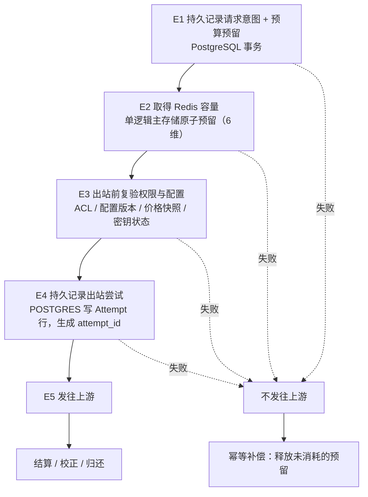
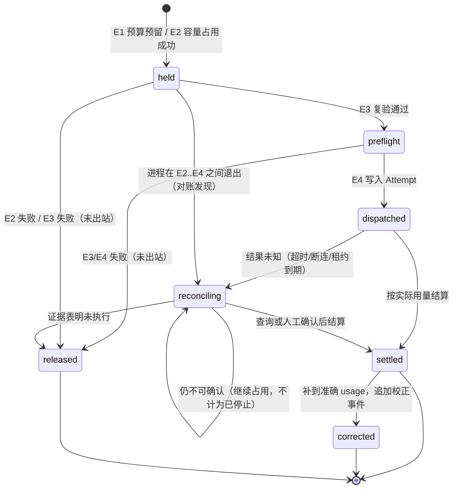
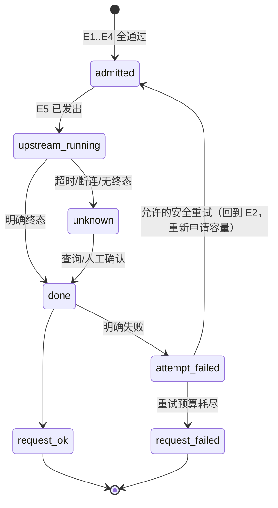
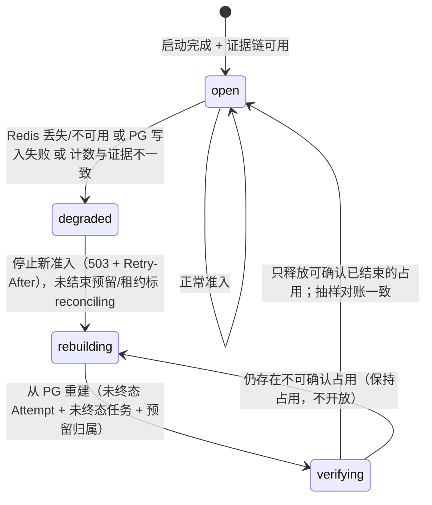

# 计量与共享容量状态流

阶段 0 · T0.6 产出。对象：把 New API 改造为多用户共享平台时的**计量口径、免费模式落点、幂等与校正、预留与对账状态机、故障降级、长流与异步任务、多 Key 与共享账户池、预算上界**。

底座固定提交：`69a50029819a26c53e6babd276d49cfe2f8880ad`（见 `docs/stage0/base-lock.md`）。本文所有底座引用都是**只读源码分析**结论，格式为 `文件:行号`。

> **核实边界**：本文只做源码与文档层面的核查。**没有编译、没有运行、没有跑测试、没有部署、没有做任何压测或安全验证**，因此不声称任何行为「已通过验证」。凡无法由源码直接确认的结论，一律在正文标注「未核实」，并在第 12 节汇总。**禁止把本文当作实现正确性的证据**；阶段 0 的验收脚本（T0.9 替身上游 + T0.8 最小可运行路径）才是。

---

## 0. 这份文档要解决的问题

计划书 §9.2 把共享容量控制列为阶段 0 的核心验收对象，并要求「一次请求只有一个权威路由决定」（§6）。底座（New API）已经有完整的**预扣费 → 结算 → 退款**计费会话链路和**配额钳制 / 饱和审计**机制，但：

| 底座的现状 | 与本项目的差距 | 本文对应章节 |
|---|---|---|
| 计费以「一次请求」为单位，日志无 Attempt 维度 | 用户请求数按 Request 计、上游请求数按 Attempt 计，两者必须分开 | §1 |
| 计费依赖用户钱包/订阅余额 | 免费共享：保留鉴权、额度与计量，去掉充值余额前置条件 | §2 |
| 计费结果写入即最终值 | 需要稳定事件 ID、重复事件幂等、后续追加校正事件并保留修订轨迹 | §3 |
| 预扣在**选渠道之前**发生（`controller/relay.go:128`） | 实际 Key 决定价格与预算，必须在路由后再定价/再预留 | §2、§7 |
| 无渠道/Key 并发槽位；`GetNextEnabledKey` 的锁只保护选择 | 需要贯穿请求生命周期的多维度原子预留 | §7 |
| Redis 只用于限流与缓存；限流在 Redis 不可用时回退进程内存 | 共享容量无法用「空计数」或「单实例内存」安全兜底 | §5 |
| 任务超时被直接判失败并退款（`service/task_polling.go:88,110-112`） | 超时不证明上游已停止，须先进入 `unknown/reconciling` | §6 |

---

## 1. 计数口径：Request / Attempt / UsageEvent

### 1.1 三个对象

| 对象 | 定义 | 何时创建 | 唯一键 | 数量口径 |
|---|---|---|---|---|
| **Request** | 一次用户调用：一个 HTTP 请求，或一次异步任务创建请求 | 准入时（§4 步骤 E1） | `platform_request_id`（UUID，全局唯一） | **用户请求数 = 1**（重试不增加） |
| **Attempt** | 一次**实际发往上游**的执行 | 出站前（§4 步骤 E4） | `attempt_id`（UUID，全局唯一） | **上游请求数 = N**，N 为该 Request 下已出站的 Attempt 数 |
| **UsageEvent** | 一条计量事实：分项用量 + 成本估算 + 可信度 + 价格/汇率快照 | 收到上游 usage、任务终态、对账补记 | `event_id`（稳定哈希，见 §3.1） | 用量按分项**累加** |

**归属关系**

```text
用户 (User)
└─ 平台 Key (APIKey)
   └─ Request  platform_request_id        ← 用户请求数在这里记 1
      ├─ 预算预留 Reservation（PG，按周期）
      ├─ 容量预留 CapacityReservation（Redis，6 维，见 §7）
      └─ Attempt  attempt_id              ← 上游请求数在这里各记 1
         ├─ 供给 ModelOffering
         ├─ 渠道 Channel
         ├─ 实际上游 Key UpstreamKey（+ credential_version）
         ├─ 价格快照 PriceSnapshot（绑定到实际 Key）
         └─ UsageEvent  event_id          ← 用量/成本累加在这里
```

一条 Request 有 1 个 `platform_request_id`、0..N 个 Attempt（默认上限 2：安全重试最多一次，计划书 §12），每个 Attempt 有 0..M 个 UsageEvent（正常 1 条最终事件；补到准确 usage 时再追加 1 条校正事件）。

### 1.2 累加规则（必须写死的口径）

| 规则 | 内容 | 依据 |
|---|---|---|
| 用户请求数 | 按 **Request** 计；一次请求内发生 1 次重试，用户请求数仍为 1 | 计划书 §8.5 |
| 上游请求数 | 按 **Attempt** 计，含失败与重试 | 计划书 §8.5 |
| 渠道 / Key 消耗 | 该渠道、该上游 Key 上**所有已知 Attempt** 的 UsageEvent 累加 | 计划书 §3.4、§8.5 |
| 失败与重试 | **也可能有成本**：只要 Attempt 已出站，上游就可能已计费，因此已出站 Attempt 的已知用量照常累加，未知用量记 `unknown` 而不是记 0 | 计划书 §8.5、§9.2-4 |
| 按请求数计价 | 以该上游的**实际计费单位**为准：一次 Attempt = 一个计费单位；重试 = 第二个计费单位，**不得压成一次** | 计划书 §8.5 |
| 流式 usage | 中间 progress 与最终累计 usage 由适配器区分，**不得相加** | 计划书 §8.5 |
| 异步任务 | 提交、轮询、终态**只能形成一份任务用量结算**；额外收费的查询操作另记一条 | 计划书 §8.5 |
| 未知用量 | 「价格未知」与「价格为零」分别存储；未知费用不累计成零 | 计划书 §8.4、§8.5 |

### 1.3 分项（不重叠计量单位）

UsageEvent 按「不重叠分项 × 对应单价」求和（计划书 §8.5），分项集合：

| 分项 | 单位 | 典型来源 |
|---|---|---|
| `input_tokens` | token | 对话、向量、重排 |
| `output_tokens` | token | 对话、语音生成 |
| `cache_read_tokens` / `cache_write_tokens` | token | 缓存语义，是否含在 `input_tokens` 内由适配器归一 |
| `reasoning_tokens` | token | **仅当上游单列且不与 `output_tokens` 重叠时**才作为独立分项 |
| `image_count` + 尺寸/质量档位 | 张 | 图片生成/编辑 |
| `audio_seconds` / `characters` | 秒 / 字符 | 语音识别、语音生成 |
| `video_seconds` + 分辨率/是否带音频 | 秒 | 视频 |
| `documents` | 个 | 重排 |
| `requests` | 次 | 按次计价的接口 |

**可信度 `confidence`** 三档：`measured`（上游返回真实 usage）/ `estimated`（本地估算，例如按请求体 token 计数）/ `unknown`（无法估算）。只有 `measured` 与 `estimated` 进入「可估算总额」，`unknown` 进入「未估算请求数」（计划书 §8.4）。

### 1.4 底座现状与必须补齐的部分

| 底座机制 | 文件:行号 | 能否直接满足 §1 口径 |
|---|---|---|
| 消费日志表 `Log`：`PromptTokens` / `CompletionTokens` / `Quota` / `ChannelId` / `TokenId` / `RequestId` | `model/log.go:59-80` | **不够**：无 Attempt 维度、无分项、无价格快照、`RequestId` 只有普通索引（`model/log.go:78`）而非唯一键，无法充当幂等键 |
| 用户用量累加 `UpdateUserUsedQuotaAndRequestCount` | `model/user.go:1440-1447` | 一次性把 `used_quota` 与 `request_count` 各加一次；**只在有计费用量时调用**（见下行），失败尝试不累加 |
| 渠道用量累加 `UpdateChannelUsedQuota` | `model/channel.go:906` | 同上，只做无幂等键的累加 |
| 文本结算处调用点 | `service/text_quota.go:454-460` | **关键**：`if !summary.hasBillableUsage()` 时**不累加用量**，`summary.Quota` 被置 0（`service/text_quota.go:376-379`），随后 `SettleBilling(ctx, relayInfo, 0)`（`:462`）会把预扣退掉。即：**上游没返回 usage 时底座按「不扣费」处理**，与本项目「未知用量照实记为未知/待核实」的要求相反 |
| 批量累加开关 | `model/user.go:1441-1444`（`common.BatchUpdateEnabled`） | 批量模式下累计值**延迟落库**，对账不能依赖即时读到的 `used_quota` |

**结论**：Request / Attempt / UsageEvent 必须是 APIGX 自己新增的持久表（T0.4 迁移草案负责表结构），不能只靠扩展底座 `logs` 表；并且**底座的 `used_quota` / `request_count` 只能作为派生视图**，权威事实是事件表。新增表一律按底座三库兼容要求书写（`docs/stage0/base-lock.md` §6-17）。

---

## 2. 免费模式（`usage_only`）的落点

### 2.1 结论先说

`usage_only` **落在底座既有的计费会话上**，做法是「在 `BillingSession` 的**资金来源（FundingSource）**维度加一个只记账、不动钱包的实现」＋「跳过用户充值余额前置检查」，而**不是**另起一套计量，也**不是**改价格数值。

依据：`docs/stage0/base-lock.md` §7-2（「在既有计费会话上做模式分支……不要另起一套计量；否则会同时违反『不另起第二套系统』和『计费安全不变量』」）与计划书 §6 末段。

### 2.2 底座既有计费会话链路（已核实）

| # | 环节 | 文件:行号 | 行为 |
|---|---|---|---|
| B1 | 中继入口估算并预扣 | `controller/relay.go:128` → `relay.PrepareRequestBilling`（`relay/request_billing.go:24-66`） | 估算 token → `helper.ModelPriceHelper`（`relay/helper/price.go:77`）算出 `PriceData` → `service.PreConsumeBilling(c, priceData.QuotaToPreConsume, info)`（`relay/request_billing.go:65`） |
| B2 | 免费模型短路 | `relay/request_billing.go:61-64` | `if priceData.FreeModel { return nil }` —— **不创建任何计费会话** |
| B3 | 预扣入口 | `service/billing.go:20-43` | 先拒绝 `relayInfo.QuotaClamp != nil`（`:21-28`）与 `preConsumedQuota < 0`（`:29-36`），再 `NewBillingSession`（`:37`），会话挂到 `relayInfo.Billing`（`:41`） |
| B4 | 选资金来源 | `service/billing_session.go:377-476` | 按 `BillingPreference` 分支 `subscription_only` / `wallet_only` / `wallet_first` / `subscription_first` |
| B5 | **余额前置条件** | `service/billing_session.go:385-401` | `tryWallet`：`GetUserQuota` 后 `userQuota <= 0` 直接 403（`:390-395`）；`userQuota-preConsumedQuota < 0` 再 403（`:396-401`） |
| B6 | 预扣执行 | `service/billing_session.go:196-250` | 信任旁路把 `effectiveQuota` 置 0（`:200-203`）→ `PreConsumeTokenQuota`（`:210`）→ `funding.PreConsume`（`:217`），失败回滚令牌额度（`:219-225`） |
| B7 | 令牌额度原子预留 | `service/quota.go:396-416` → `model.TryReserveTokenQuota`（`model/quota_reserve.go:203-240`） | Redis Lua 原子判定并扣减（`model/quota_reserve.go:42-55,94-98`），随后持久化（`persistTokenQuotaDelta`，`:123-130`），持久化失败则补偿缓存（`:232-238`） |
| B8 | 结算 | `service/billing.go:51-95` → `BillingSession.Settle`（`service/billing_session.go:43-81`） | `delta = actualQuota - preConsumedQuota`，先调 `funding.Settle(delta)`（`:56`）再调令牌额度（`:65-67`）；资金来源已提交后令牌失败只记日志（`:69-73`） |
| B9 | 失败退款 | `relay/request_billing.go:70-80` → `BillingSession.Refund`（`service/billing_session.go:84-125`） | 幂等守卫 `settled / refunded / fundingSettled`（`:86`、`:134-147`），异步 `gopool.Go` 执行（`:108`） |
| B10 | 路由后再定价/再预留的**既有钩子** | `service/tiered_settle.go:191-199`、`service/image_billing.go:78-93` | 选中渠道后若尚无会话则 `PreConsumeBilling`，已有会话则 `Billing.Reserve(quota)`（`service/billing_session.go:154-188`） |

### 2.3 `usage_only` 需要修改的调用链环节（逐项）

| 环节 | 文件:行号 | 现状 | `usage_only` 应做的分支 | 必须保持的不变量 |
|---|---|---|---|---|
| 模式判定 | `service/billing_session.go:377-382` | 只读用户的 `BillingPreference`（`common.NormalizeBillingPreference`） | 平台级 `usage_only` 模式**优先于**用户偏好，直接进入专用分支 | 判定必须服务端强制，不能被用户设置放宽 |
| 余额前置 | `service/billing_session.go:390-401` | `userQuota <= 0` 或不足即 403 | **移除用户钱包余额前置检查**；保留平台 Key 额度检查（B7） | 不得伪造余额（见 §2.4）；`TryReserveTokenQuota` 的 `quota < 0` 拒绝（`model/quota_reserve.go:204-206`）必须保留 |
| 资金来源 | `service/billing_session.go:252-289`（`reserveFunding` 的 `switch`） | `WalletFunding` / `SubscriptionFunding` | 新增 `UsageOnlyFunding`：`PreConsume` / `Settle` / `Refund` 只驱动**用量与成本账**（写 UsageEvent、更新派生视图），不调用 `DecreaseUserQuota` / `IncreaseUserQuota` | `default` 分支的错误处理（`:286-288`）保留，未知 funding 必须报错而不是静默通过 |
| 预扣额度 | `service/billing_session.go:196-250` | 令牌额度 + 资金双扣 | **保留**令牌（平台 Key）额度原子预留；资金侧预扣为 0 | `service/billing.go:21-36` 的 clamp / 负值拒绝不得删除 |
| 信任旁路 | `service/billing_session.go:317-350` | 余额与令牌都超过 `TrustQuota` 时 `effectiveQuota = 0`，**连令牌预扣也跳过** | 旁路只应影响钱包侧；APIGX 的容量预留**不得以 `effectiveQuota` 为前提** | 见 §7：容量判定独立于 `effectiveQuota` |
| 结算 | `service/billing.go:51-95`、`service/billing_session.go:43-81` | 差额调整钱包 + 令牌 | 差额只驱动用量/成本账与令牌额度；钱包不动 | 差额仍可正可负；饱和 clamp 必须上报（§10） |
| 失败退款 | `service/billing_session.go:84-125` | 退回预扣资金 + 令牌 | **注意**：不得在「结果未知」时立即退款（§6.4）；退款本身仍走同一幂等守卫 | `needsRefundLocked`（`:134-147`）的三个标志位语义不得破坏 |
| 免费短路 | `relay/request_billing.go:61-64` | `FreeModel` 直接 `return nil`，**不建会话** | **不得**把 `usage_only` 实现为 `FreeModel`：`usage_only` 必须仍然建立会话，才能结算与写计量 | 否则下游既无 settle 也无日志 |
| 免费判定的来源 | `relay/helper/price.go:149-165`（文本）、`:268-273`（按次）、`:401-407`（tiered） | 分组倍率 = 0、`modelPrice == 0` 或 `modelRatio == 0` 即 `FreeModel = true` | `usage_only` 下**不得**让价格或倍率为 0 | 价格必须保持正的参考值（计划书 §8.5） |
| 异步任务预扣 | `relay/relay_task.go:334-339` | `if info.Billing == nil && !info.PriceData.FreeModel` 才预扣，并置 `ForcePreConsume = true` | `usage_only` 分支必须同样覆盖异步任务路径 | `ForcePreConsume`（`relay/common/relay_info.go:135-138`）语义保留 |
| 路由后补建会话 | `service/tiered_settle.go:191-193`、`service/image_billing.go:78-84` | 「选中付费组后补建/追加预留」的既有形态 | APIGX 的「选定供给与 Key 后再绑定价格快照并预留」**按这个形态落位** | 已有会话走 `Reserve`（`service/billing_session.go:154-188`），不得绕过 |

### 2.4 明确禁止的替代做法

| 禁止做法 | 为什么禁止（含证据） |
|---|---|
| **把模型价格统一设为 0** | 触发 `relay/helper/price.go:151-164` 的 `freeModel = true`（组倍率为 0、或 `usePrice` 时 `modelPrice == 0`、或按倍率时 `modelRatio == 0`）→ `relay/request_billing.go:61-64` 直接跳过预扣 → `QuotaToPreConsume = 0`，估算成本恒为 0，破坏「记录正参考价格」与预算预留；同时把「分享者声明的真免费模型」与「平台不计费的 usage_only」混为一谈，界面无法区分 |
| **给所有用户超大余额** | 破坏 `common/quota_math.go:16`（`MaxWalletQuota = 1<<53-1`）与 `ValidateWalletQuota`（`:22-27`）的语义；更关键的是 `shouldTrust`（`service/billing_session.go:317-350`）在余额/令牌超过 `TrustQuota` 时把 `effectiveQuota` 置 0，**连令牌额度预扣都跳过**，计量与预留同时失真。并发下「先读余额再扣」仍会被击穿（底座自己在 `model/quota_reserve.go:203-240` 已经改成原子预留来避免这一点） |
| **把用户分组倍率设为 0 当免费** | 同样命中 `relay/helper/price.go:151-153`（`groupRatioInfo.GroupRatio == 0 → FreeModel`）与 `:403-406`（tiered） |
| **关闭 `EnableFreeModelPreConsume` 当免费开关** | 该开关只控制「是否跳过预扣」（`relay/helper/price.go:149`、`:268`、`:402`），不是计费模式；关掉它等于放弃预扣保护，反而更容易击穿额度 |
| **另起一套计量（不经过 `BillingSession`）** | 违反 `docs/stage0/base-lock.md` §7-2，且会绕过 B3 的 clamp/负值校验与 B8 的结算一致性 |
| **在 `usage_only` 下跳过平台 Key 额度检查** | 计划书 §6 明确要求「保持鉴权、额度与计量」；平台 Key 额度是使用者侧唯一的硬闸门 |

### 2.5 免费模式与「正成本估算」同时成立

计划书 §11 阶段 0 验收要求「无余额但正成本估算」。因此 `usage_only` 下：

- 价格仍走 `helper.ModelPriceHelper`（`relay/helper/price.go:77`）得到正的 `PriceData`；
- 预估金额仍用 `common.QuotaFromFloatStrict`（`relay/helper/price.go:131,218`、`:264,277`）计算并记录；
- 结算仍调用 `SettleBilling`（`service/text_quota.go:462`）与用量累加（`:458-459`）；
- **只有钱包/订阅的资金变动被替换为记账**，其余全部保留。

---

## 3. 幂等与校正

### 3.1 稳定事件 ID

```text
event_id = HASH(platform_request_id ‖ attempt_id ‖ event_kind ‖ usage_revision ‖ producer)
```

| 组成 | 说明 |
|---|---|
| `platform_request_id` | 一次用户调用 |
| `attempt_id` | 一次上游执行；Request 级事件（例如准入、预算预留）用占位值 |
| `event_kind` | `usage_progress` / `usage_final` / `task_settle` / `correction` / `release` / `refund` |
| `usage_revision` | 同一 attempt 内的修订序号，从 1 递增 |
| `producer` | `relay` / `task_worker` / `reconciler` / `admin` —— 同一事实由不同生产者上报时不会互相冒充 |

`event_id` 存**唯一约束**。事件表只追加，不 UPDATE、不 DELETE。

### 3.2 重复事件幂等

| 场景 | 处理 |
|---|---|
| 同一事件被重复投递（重试、Worker 重启、网关重发、回调与轮询竞争） | 以 `event_id` 唯一约束拦下；只有**真正插入成功**的那一次才驱动副作用（用量累加、派生视图更新、告警） |
| 回调与轮询同时给出同一终态 | 同一 attempt 的终态转移用**条件更新（CAS）**，只有一个赢家；底座已有该形态可参照：`model/task.go:533-539` 的 `UpdateWithStatus(fromStatus)`（注释明确说明为什么不用 `Save()`） |
| 底座的 bulk 更新 | `model/task.go:541-545` 明确警告 `TaskBulkUpdateByID` **无 CAS，禁止用于计费/配额生命周期**；APIGX 的归还、终态、校正一律不得用它 |
| 流的中间 usage 与最终 usage | `usage_progress` 与 `usage_final` 是不同 `event_kind`；结算只用 `usage_final`（或按适配器规则由 `usage_final` 覆盖 progress），**不得相加** |
| 任务提交 + 轮询 + 终态 | 只允许一条 `task_settle` 生效：`(attempt_id, 'task_settle')` 唯一，或由任务状态 CAS 保证「先到者结算」 |
| 底座的「退款幂等」先例 | `service/task_billing.go:216-258` `RefundTaskQuota`：`task.Quota == 0` 直接返回 true（`:218-220`），退款成功后把 `task.Quota` 清零并回写（`:253-256`）——**这就是一个可复用的「一次性款项」幂等形态** |

### 3.3 后续补到准确 usage 时：追加校正事件

**不覆盖历史证据**：原估算事件原样保留，另追加一条 `kind = correction` 的事件，携带：

| 字段 | 含义 |
|---|---|
| `supersedes_event_id` | 被修订的原事件 ID（保留修订轨迹） |
| `usage_revision` | 修订序号（原事件为 n，校正为 n+1） |
| `corrected_*` | 修订后的分项用量与成本 |
| `original_estimated_*` | 原估算值（冗余保存，便于审计时直接对照，不必回查） |
| `reason` / `price_snapshot_id` / `fx_snapshot_id` | 修订原因与所用快照 |
| `period_key` | **原预留周期**（见 §3.4） |

**底座已有同类先例**：`service/task_billing.go:264-331` `RecalculateTaskQuota` 在任务结算日志的 `other` 中**同时**保存 `pre_consumed_quota` 与 `actual_quota`（`:314-315`），并按差额方向写一条 consume 或 refund 日志（`:303-330`），即「保原值 + 追加差额」而不是改写原记录。APIGX 沿用这一形态，并把它升级为带唯一 `event_id` 的事件表。

**校正也必须走底座配额不变量**（见 §10）：换算用 `common.QuotaFromFloat*` / `QuotaFromDecimal*` 的 `Checked` 变体，并把 `*QuotaClamp` 记入审计。

### 3.4 预算回到原预留周期

| 机制 | 内容 |
|---|---|
| 周期标识 | 每条 Reservation 与每个 UsageEvent 都带 `admission_day`（按 **Asia/Shanghai** 划分的准入日）、`period_key`（日限额/预算窗口键）、`policy_version`（该周期的限额与价格策略版本） |
| 跨日结算 | 请求在 23:59 准入、00:03 结算时，差额与校正事件**按 `period_key` 回写原周期**，不落到结算发生日 |
| 价格与汇率 | 价格快照与汇率版本绑定 Request/Attempt；历史估算不随汇率更新改写（计划书 §8.5、§12） |
| 底座的障碍 | `model/log.go:62` 的 `CreatedAt` 是**写日志的时刻**，日志表无法表达「归属准入日」→ APIGX 必须在自己的表上保存准入日与周期键，**不能靠 `logs.created_at` 反推周期** |
| 时间存储 | 统一 UTC 存储，日限额按 Asia/Shanghai 计算，配置版本与请求准入日一起保存（计划书 §8.5、`CODE_STYLE.md` 第 3 条） |
| 预留释放的周期归属 | 未消耗的预留释放也回到原周期，避免把「昨天没用掉的额度」算进今天 |

### 3.5 幂等实现的三库注意点

新增事件的唯一约束与「插入或忽略」语义要求 GORM 层可移植（`docs/stage0/base-lock.md` §6-17 明确：SQLite / MySQL ≥ 5.7.8 / PostgreSQL ≥ 9.6 三库都要真实跑过，单元测试/ mock / 只跑一种方言都不算验证）。**具体 upsert 写法在三库下的等价性本文未核实**，列入 §12，须在阶段 0/1 用真实三库各验一次。

---

## 4. 执行顺序、状态转换与失败补偿

### 4.1 五步执行顺序（计划书 §9.2 末段）



**硬规则**：任一步失败**不得发送**。E1..E4 的任一失败都在**未出站**状态下发生，因此没有上游成本，可以安全释放全部预留；E5 一旦开始，Attempt 即为既成事实，不再整笔释放（§4.3）。

### 4.2 逐步失败行为

| 步骤 | 载体 | 失败时的确定行为 | 补偿 |
|---|---|---|---|
| E1 记录意图 + 预算预留 | PG，单事务 | 返回 5xx，**不申请容量、不发送** | 事务回滚即无残留；若已提交但进程退出，由对账按「有预留、无 Attempt、超短 T」释放 |
| E2 取得 Redis 容量 | Redis，单逻辑主存储的原子操作/Lua | 容量不足 → 该候选不可用 → 调度器在合格集中**重选**；全部满载 → `429` + `Retry-After` | 释放 E1 的预算预留（幂等） |
| E3 出站前复验权限与配置 | 无写入 | 权限/授权已撤销、供给已暂停、配置版本变化、Key 已失效/冷却 → **不发送** | 释放 E2 容量 + E1 预算预留 |
| E4 持久记录出站尝试 | PG | 写失败 → **不发送** | 释放 E2 + E1；绝不允许「先发后记」 |
| E5 发往上游 | 网络 | 成功/失败/未知三种结果，见 §4.3 | 按结果结算或进入 `reconciling` |

**E2 为什么必须是原子操作**：计划书 §9.2-1 明确「仅『先读计数再发送』会在并发下突破上限」。底座在同一问题上已经给出过正解：`model/quota_reserve.go:42-55` 用 Lua 把「检查 + 扣减」合成一步（`cacheTryReserveTokenQuota`，`:94-98`）。

**E4 为什么必须在发送之前**：这是「进程在步骤之间退出」可被对账的前提。没有 Attempt 行，就无法区分「已出站」与「未出站」，只能保守地保留或错误地释放。

### 4.3 E5 之后的三种结果

| 结果 | 判定 | 计量与占用 |
|---|---|---|
| 明确成功 | 同步响应正确结束 / 流完整结束 / 任务终态成功 | 写入 `usage_final`（`measured` 或 `estimated`），结算差额，归还容量槽位 |
| 明确失败 | 上游 4xx/5xx、连接被拒、鉴权失败等**可判定未执行或执行失败** | 已出站 → 保留 Attempt 与已知/未知成本；本轮容量槽位归还；是否可重试由 §9.5 决定（默认总重试预算 2 次 Attempt） |
| **结果未知** | 超时、断连、租约到期、上游无终态 | **不归还为「空闲」**：进入 `unknown`，容量保持占用并转入 `reconciling`（§6.3） |

### 4.4 状态转换

#### (a) 预留（Reservation）生命周期



**`held → released` 只能走 §4.2 的四种「未出站」路径**；一旦 `dispatched`，释放必须基于证据（结算、确认未执行），不得只因为「超过某个时间」就放行。

#### (b) 请求 / 尝试视角



**重试规则**：重试必须**为目标渠道重新获取容量**（计划书 §9.2-4）；已发往上游的请求次数或已消耗 token **不因请求失败全部退回**；Key 切换与渠道切换**共用同一个总重试预算**（计划书 §9.5）。

### 4.5 对账进程（reconciler）

对账进程处理「进程在步骤之间退出」的情况，必须能**从持久证据重建真相**：

| 扫描对象 | 判据 | 动作 |
|---|---|---|
| 有 Reservation、无 Attempt，且 `now - created_at > T_short`（秒级） | 未出站 | 释放预留（含 Redis 容量与预算），写 `release` 事件 |
| 有 Attempt、无终态，且 `now - dispatched_at > 适配器服务时限` | 出站但结果未知 | 转 `reconciling`，**保持占用**；同时按 §9.4 记入服务质量「超时」窗口 |
| 有 Attempt、无 UsageEvent | 上游未返回用量 | 按本地估算写 `estimated` 事件，或写 `unknown`；**不得记 0**（§1.2） |
| 有 UsageEvent、后来补到准确 usage | 修订 | 追加 `correction` 事件，回写原 `period_key`（§3.3、§3.4） |
| Redis 侧存在占用、PG 侧无对应 Attempt | 孤儿占用 | 不直接清零；进入 `degraded` 并按 §5 重建 |
| 任务类：占用中但任务已终态 | 漏归还 | 幂等归还（attempt_id 为幂等键），重复归还无副作用 |

对账动作本身也必须幂等（`release` / `correction` 都由 `event_id` 去重），且对账**不得**修改已终态的历史事件。

---

## 5. 故障降级

### 5.1 两类故障的共同要求

**Redis 状态丢失**（进程重启、`FLUSHALL`、主从切换、网络分区）或**数据库写入失败**时：**暂停新准入，恢复并对账后再开放；不能从空计数直接恢复为全部空闲**（计划书 §9.2）。

### 5.2 底座里能用的与不能用的

| 机制 | 文件:行号 | 对 APIGX 的意义 |
|---|---|---|
| ✅ **可参照**：Lua 原子预留 + PG 持久化 + 失败补偿 + **cache miss 时从 DB 重建再重试** | `model/quota_reserve.go:20-104`（脚本与调用）、`:106-130`（持久化）、`:203-240`（编排；`:218-222` 是 hydrate 重试，`:232-238` 是补偿） | 这是「Redis 预留 + PG 权威 + 可重建」的既有正解形态 |
| ⚠️ **不能照搬**：Redis 不可用时**回退到进程内存限流** | `middleware/rate-limit.go:147-158`、`middleware/model-rate-limit.go:196-200`；`common/redis.go:17,24-26`（启动 Ping 失败即 `RedisEnabled = false`） | 进程内存计数在多实例下各自独立，**会把容量放大 N 倍**。共享容量**不得**采用这种降级；这正是计划书禁止「空计数恢复为全部空闲」的同类风险 |
| ⚠️ 令牌额度的 DB 回退 | `model/quota_reserve.go:213-215,223-227` | 令牌额度是**单行可重建**的量，所以回退数据库是安全的；但**渠道/Key/账户池并发是聚合量，无法由单行重建**，因此需要不同的处置 |
| ⚠️ 批量累加延迟落库 | `model/user.go:1441-1444` | 对账不能依赖即时读到的累计值 |

### 5.3 准入闸门（admission gate）状态机



| 阶段 | 新请求 | 已有占用 | 说明 |
|---|---|---|---|
| `open` | 正常准入 | 正常 | — |
| `degraded` | **拒绝**（503/429 + `Retry-After`） | 一律**不**视为已释放 | 宁可少服务，不可超发 |
| `rebuilding` | 拒绝 | 标 `reconciling` | 从 PG 证据重建 |
| `verifying` | 拒绝 | 可确认已结束的释放 | 一致后才开放 |

**开放判据不是「Redis 里计数为空」，而是「PG 证据链已重建，且重建结果与证据一致」**。底座在 `model/quota_reserve.go:218-222` 已经示范了「miss 就重建」而不是「miss 就当空闲」。

### 5.4 三类占用的分别恢复

| 类别 | 载体 | 恢复依据 | 恢复前的行为 |
|---|---|---|---|
| **HTTP 请求槽位** | Redis 6 维容量预留（§7） | 未终态 Attempt 是否存在 + 适配器服务时限 | 新请求 503/429；不提前放行 |
| **长流租约** | Redis lease（TTL + 续租） | 连接/流状态、终态事件、续租心跳 | 租约到期**只**进入 `reconciling`，不直接释放 |
| **持久异步任务** | PG 任务行（`model/task.go:50-70`） | 任务状态 + 主动查询上游 + 人工确认 | 占用保持到终态或**经过确认的取消** |

三者的恢复**分别进行**，不能因为 Redis 重建完成就同时清空异步任务占用，也不能因为任务行存在就假定 HTTP 槽位仍然被占。

### 5.5 数据库写入失败

| 失败点 | 行为 |
|---|---|
| E1（意图 + 预算预留） | 事务未提交 → 无残留，返回 5xx；**不申请容量、不发送** |
| E4（出站尝试记录） | **不发送**；释放已取得的 Redis 容量与预算预留。理由是「持久记录出站尝试」是发送的前提，缺它就失去对账能力 |
| 结算/校正写库失败 | 保留 `reconciling`，由对账重试；幂等键保证重试不重复计量。参照底座 `service/billing_session.go:69-73` 的态度：**宁可记账不平也不能重复退款**，并把异常显式记日志 |
| 释放预留写库失败 | 保留占用并重试；**不得**因为写失败而假定已释放 |

---

## 6. 长流与异步任务

### 6.1 唯一 attempt ID 保证归还幂等

- 每次出站分配 `attempt_id`；**归还（释放容量槽位）以 `attempt_id` 为幂等键**，重复归还是无副作用的空操作。
- 归还使用条件更新（CAS）形态，参照 `model/task.go:533-539`；不得使用无 CAS 的 bulk 更新（`:541-545` 明确禁止用于计费/配额生命周期）。

### 6.2 长流续租

| 项 | 设计 |
|---|---|
| 租约 | 每个进行中的流持有一个 lease，TTL 短（秒级），由持有者定期续租 |
| 续租失败 | 不立即释放；lease 到期后进入 `reconciling`，由对账按 §5.4 处置 |
| 为什么不能提前放行 | 计划书 §9.2-2：「不能简单提前放行仍在上游运行的请求」 |
| 与 HTTP 槽位的关系 | 流在手期间，请求槽位**一直持有到实际结束**（计划书 §9.2-2） |

### 6.3 进程异常后的恢复路径

```text
进程退出
  → ① 租约/槽位到期（expiry sweeper）
  → ② 查询任务/上游状态（polling）
  → ③ 补偿对账（reconciler）
  → ④ 证据充分才归还；证据不足保持 reconciling
```

### 6.4 异步任务

**占用规则**：视频等任务**提交成功后持续占用，直到终态或经过确认的取消**；不能因为 HTTP 提交响应结束就释放（计划书 §9.2）。

**底座现状与必须的修改**（重要，直接影响验收场景「Redis 丢失或持久写入失败」与「异步结果未知」）：

| 底座行为 | 文件:行号 | 与计划书的冲突 | 必须怎么改 |
|---|---|---|---|
| 任务超时扫描把任务置 `TaskStatusFailure` 并**退款** | `service/task_polling.go:69-118`（置失败 `:88`、CAS `:100`、退款 `:110-112`） | 计划书 §9.2：「任务超时、断网或租约到期**不证明上游已经停止**：先进入 `unknown/reconciling`」 | 超时 → 记入服务质量「超时」窗口（§9.4），**同时**生成 `reconciling` 的计量与占用记录；只有在查询/人工确认未执行后才释放并退款 |
| 超时阈值来自环境变量 | `constant.TaskTimeoutMinutes`（`common/init.go:203`，`TASK_TIMEOUT_MINUTES`，默认 1440 分钟） | 阈值只是「多久后开始怀疑」，不是「证明已停止」 | 语义上分为「服务质量超时」（进窗口）与「计量确认」（进 reconciling）两件事，计划书 §9.4 末段也要求二者分开记录 |
| 已存在 `UNKNOWN` 状态 | `model/task.go:43`（`TaskStatusUnknown = "UNKNOWN"`）；轮询中对未知状态有专门处理 `service/task_polling.go:316,536` | 可复用 | 复用 `UNKNOWN` 作为「上游结果不可知」的落点，并在其上叠加本项目的 `reconciling` 计量标记 |
| 任务终态与退款幂等 | `service/task_billing.go:216-258`（`task.Quota == 0` 短路；退款后清零回写） | 可复用 | 作为「一次性款项」的幂等形态沿用 |
| 任务状态 CAS | `model/task.go:533-539` | 可复用 | 归还/终态用 CAS |
| 无「服务时限」概念与任务规格上界 | — | 计划书 §9.5 要求每个适配器定义连接超时、首输出/空闲超时、请求总时限与任务最长等待时间 | 新增按适配器的时限配置；**未核实**底座是否已有等价配置（见 §12） |

**红线**：不得长期保持 `pending` 来抬高可靠性（计划书 §9.2）；超时仍要记入服务质量降级。

---

## 7. 多 Key 与共享账户池

### 7.1 两级决策分离

| 决策 | 由谁决定 | 内容 |
|---|---|---|
| 选渠道 / 供给 | **使用者** | 指定某个分享供给，或按延迟/吞吐/可靠性/综合策略自动选 |
| 选 Key | **分享者** | 该渠道内按轮询/随机/加权/剩余容量分配 |

使用者**不必也不能**通过公开接口索取实际密钥（计划书 §9.2）。

### 7.2 底座里 Key 选择实际发生在哪里（已核实）

| 位置 | 文件:行号 | 行为 |
|---|---|---|
| 渠道分配阶段的 Key 选择 | `middleware/distributor.go:677` | 调用 `channel.GetNextEnabledKey()`，把结果写入 `ContextKeyChannelKey`（`:689`，常量定义 `constant/context_key.go:41`），并记录 `ContextKeyChannelMultiKeyIndex`（`:683`） |
| 转发器读取该 Key | `relay/common/relay_info.go:261` | `ApiKey: common.GetContextKeyString(c, constant.ContextKeyChannelKey)` |
| Key 选择实现 | `model/channel.go:206-290` | 多 Key 模式：`random`（`:250-253`）与 `polling`（`:254-285`）；互斥锁 `GetChannelPollingLock`（`:219-221`，实现见 `:642-643`）**只包住选择过程本身** |
| **二次选择风险点 ①** | `relay/relay_task.go:100-114` | 复用原任务渠道时**再次**调用 `ch.GetNextEnabledKey()`（`:101`）并覆写 `ContextKeyChannelKey`（`:105`）、`info.ApiKey`（`:113`） |
| **二次选择风险点 ②** | `controller/channel_inference.go:92` | 模型发现/推理测试路径 |
| **二次选择风险点 ③** | `controller/channel_upstream_update.go:389,438,468`、`controller/ratio_sync.go:337` | 上游目录拉取与价格同步路径 |
| 其他 Key 读取者 | `service/midjourney.go:319`、`relay/channel/tencent/adaptor.go:72` | 直接读 context 中的 Key |

**结论**：底座确实存在多处「转发期间再次抽选 Key」的入口。计划书 §6 要求「转发器接收确定的渠道和凭据引用，不能在原生 `GetNextEnabledKey` 中再次抽选」——因此 APIGX 的调度器必须**先定 Key 再进入转发**，并把这些调用点改为「已有确定 Key 则直接使用」（或改为按 ID 取指定 Key）。

### 7.3 六维原子预留

一次请求需要在**同一个原子操作**内判定并占用以下维度：

| # | 维度 | 说明 |
|---|---|---|
| 1 | 用户 | 账号级 RPM/TPM/并发/日用量 |
| 2 | 平台 Key | 该使用者的接入 Key 级限额 |
| 3 | 渠道 | `Channel` 级并发 / RPM / TPM / 运行任务数 |
| 4 | 实际上游 Key | `UpstreamKey` 独立并发 / RPM / TPM / 预算 / 到期 / 冷却 |
| 5 | 模型供给 | `ModelOffering` 级规格上限（输入、最大输出、图片尺寸、音视频时长） |
| 6 | 上游共享账户池 | 同一上游账户下多模型、多 Key、多渠道共用的额度池 |

**规则**：

- 任一维度失败 → **本次未生效的预留全部撤销**（原子操作内不得产生部分占用）→ 调度器在合格集中**重选** Key 或渠道（计划书 §9.2-1）。
- 池已满时，即使某把 Key 的独立计数未满也**不可分配**（计划书 §9.2 示例：A/B 同属已满账户池时不得继续分配）。
- 全部候选暂时满载 → 默认 `429`；可配置有上限的短等待与公平排队（计划书 §9.2-5）。
- **不得**把 `model/channel.go:219-221` 的互斥锁当作并发上限——它只保护轮询索引的读写。定向检索**未发现**底座在 relay 路径上存在渠道或 Key 级别的在途请求计数（详见 §12）。
- 容量判定**不得**以 `relayInfo` 的 `effectiveQuota` 为前提（见 §2.3 信任旁路一行）。
- 第一版用**单逻辑 Redis 主存储**的原子操作，暂不部署需要跨分片原子操作的 Redis Cluster（计划书 §9.2）。

### 7.4 价格与预留绑定「实际执行的 Key」

- 同一渠道内不同 Key 可能对应不同上游分组/折扣/计费档位（计划书 §3.5）→ **确定实际 Key 之后**才绑定价格快照与该价格下的预算预留。
- 不得用池内最低价代表所有调用（计划书 §3.5、阶段 4 验收「Key 价格或上游分组倍率不同」）。
- 落位方式参照底座的「路由后再定价/再预留」既有钩子：`service/tiered_settle.go:191-199`、`service/image_billing.go:78-93`。
- 注意底座现状是**先预扣费再选渠道**（`controller/relay.go:128` 在 `:145` 的重试循环之前），所以这条改造必须显式改动调用顺序，属于 `docs/stage0/base-lock.md` §8 要求登记的高风险改动。

### 7.5 Key 生命周期与在途对象

| 情形 | 行为 |
|---|---|
| Key 鉴权失败 | 隔离该 Key（计划书 §9.2） |
| Key 级限流 | 仅该 Key 冷却 |
| 账户级/渠道级故障 | 同步作用于对应共享范围，遵守上游限流语义 |
| 绑定对象的后续请求 | 会话、文件、缓存、异步任务绑定创建它的渠道/Key/凭据版本；查询、取消、下载**不参与普通轮询**；未证明可迁移时禁止换 Key 或跨渠道切换（计划书 §9.2、§9.5） |
| Key 切换重试 | 属于上游重试，遵守总重试预算（默认共 2 次 Attempt），**不得**在渠道重试外再叠加无限 Key 重试 |

---

## 8. 预算上界（TPM 与 USD）

### 8.1 必须使用可执行的规格上限

TPM 与 USD 预算预留必须由**可执行的输入/输出/媒体规格上限**推导，而不是由「期望值」推导：

| 维度 | 底座已有的上界（可直接复用） | 文件:行号 |
|---|---|---|
| 图片张数 `n` | `dto.MaxImageN = 128` | `relaykit/dto/openai_image.go:15` |
| `max_tokens` 族 | `maxTokensLimit = math.MaxInt32 / 2` | `relay/helper/valid_request.go:124` |
| 任务视频时长 | `relaycommon.MaxTaskDurationSeconds = 3600` | `relay/common/relay_utils.go:146` |

同时必须覆盖**绕过标准 DTO 校验的路径**：passthrough 字段（如 `Extra["parameters"]`）、任务 `metadata` map、multipart 表单字段；任何从这些路径读取倍数/时长的适配器都要在本地施加同一上界（底座 AGENTS.md「Billing safety invariants」明确要求）。**具体有哪些 passthrough 入口本文未逐一核实**（见 §12）。

### 8.2 不得宣称严格遵守的情形

| 情形 | 允许的表述 | 禁止的表述 |
|---|---|---|
| 接口**不能限制最大输出**（无 `max_tokens` 语义，或上游忽略该参数） | 只能按请求数 / 并发 / 时长 / 张数等**数量硬限制**约束；界面标注「不保证 token 或金额上限」 | 不得宣称「严格遵守 token 上限」或「严格遵守 USD 预算」 |
| 价格未知 | 显示「未定价」，按数量限额共享 | 不得按 0 计 |
| 汇率未知 | 保留原币种金额，USD 标为待换算，计入未估算数量 | 不得当作 0 USD 汇总 |

（依据：计划书 §9.2 末段、§8.4-8、§8.5。）

### 8.3 USD 硬预算的参与条件

**配置了 USD 硬预算、但价格、汇率或消耗上界未知的供给，不参与该预算下的调用**（计划书 §9.2 末段）。分享者可改用明确的**请求数/时长**等限制；**没有 USD 预算的未定价资源仍按数量限额共享**。

| 供给状态 | 有无 USD 硬预算 | 是否可被该预算下的请求选中 |
|---|---|---|
| 价格已知 + 汇率已知 + 规格上限可执行 | 有 | ✅ 可参与，按上界预留 |
| 价格未知或汇率未知 | 有 | ❌ 不参与 |
| 最大输出无法限制 | 有 | ❌ 不参与（无法给出金额上界） |
| 价格未知 | 无 | ✅ 可参与，按数量限额 |

### 8.4 预留计算的不变量

- 所有乘积只经 `types.PriceData.AddOtherRatio` / `ReplaceOtherRatios` 写入（`types/price_data.go:35-43`、`:45-51`），该函数拒绝非正数、`NaN`、`+Inf`（`:106-108`）；**不得**直接写未导出的 `otherRatios`。
- 换算只用 `common.QuotaFromFloat*` / `QuotaRound*` / `QuotaFromDecimal*`（`common/quota_math.go:112-175`），禁止裸 `int(...)` 强转。
- 预留金额换算用 `*Strict` 变体（饱和即拒绝请求），结算用 `*Checked` 变体并把 clamp 上报（§10）。

---

## 9. 明确无法保证的维度

本节按题目要求逐条写明：**平台不承诺绝对上限**。

| # | 无法保证的维度 | 说明 | 依据 |
|---|---|---|---|
| 1 | **分享者在平台外的消耗** | 平台只能控制经由本平台的请求与已配置的共享限额池。分享者在自己上游账户里的其他使用量，平台无从得知 | 计划书 §9.2 末段 |
| 2 | **上游账户被多系统共用** | 同一上游 Key/账户被其他系统或他人使用时，平台看到的余量与上游真实余量不一致。不能承诺「上游账户在所有系统中的总消耗都受本平台约束」；不同用户暗中共享同一上游账户也无法仅凭 Key 自动推断 | 计划书 §9.2 末段 |
| 3 | **未知 usage** | 上游未返回准确用量时，本地估算或 `unknown` **不等于**实际计量；不能当作上游账单 | 计划书 §8.5 |
| 4 | **上游账单差异** | 采购折扣、赠送额度、上游分组倍率、地区价格、阶梯/档位、缓存计费口径、Batch 折扣等都可能使估算与账单不一致。估算成本**不构成应付账单** | 计划书 §8.3、§8.5 |
| 5 | **上游是否已停止执行** | 超时、断网、租约到期都**不证明**上游已经停止；可能仍在上游运行并计费 | 计划书 §9.2 |
| 6 | **绝对额度上限** | 因为 1–5，平台只能承诺「经由本平台的准入不突破已配置上限」，**不承诺**任何绝对金额或 token 上限 | 计划书 §10.2 |
| 7 | **质量与价格的普适性** | 广场数值是平台观察到的历史质量，不承诺所有用户本地网络得到同样结果；参考价格不代表具体渠道实付成本 | 计划书 §8.3、§9.4 |
| 8 | **本文的实现正确性** | 本文全部为设计结论，未经运行验证 | 本文核实边界 |

---

## 10. 与底座计费不变量 / 强制规范的兼容对照

这是本文与 `docs/stage0/base-lock.md` §6 的对接表：**我们的每一个环节如何不破坏底座已有的配额钳制与饱和审计不变量**。

| 我们的环节 | 底座机制 | 文件:行号 | 我们怎么用才不破坏它 |
|---|---|---|---|
| 预估金额换算 | `QuotaFromFloat` / `QuotaFromFloatChecked` / `QuotaFromFloatStrict` | `common/quota_math.go:112-127` | 预扣估算用 `Strict`（饱和即拒绝，例如 `relay/helper/price.go:131,218,264,277` 的既有用法）；禁止裸 `int(...)` |
| 结算换算 | `QuotaRound` / `QuotaRoundChecked` / `QuotaFromDecimal*` | `common/quota_math.go:133-168` | 分级/结算路径统一用 `QuotaRound`，避免 ±1 差异；读取 clamp 用 `Checked` |
| 用户可控倍数 | `types.PriceData.AddOtherRatio`（拒绝非正 / NaN / +Inf） | `types/price_data.go:35-43,106-108` | 张数、秒数、档位等倍数**先上界校验**再经此写入；不得直接写私有 `otherRatios` |
| 饱和审计（同步/流式） | `noteQuotaClamp` → `relayInfo.QuotaClamp` → `attachQuotaSaturation` → `other.admin_info.quota_saturation` | `service/text_quota.go:195-202`、`relay/common/relay_info.go:169-172`、`service/log_info_generate.go:36-47`、`:26-31` | 新增的计费/校正路径必须把 `*QuotaClamp` 挂到 `RelayInfo`，并在写消费日志前 `attachQuotaSaturation`；否则饱和事件无法审计 |
| 饱和审计（任务） | `noteTaskQuotaClamp` → `attachQuotaSaturationToOther` | `relay/relay_task.go:430-437`、`service/task_billing.go:316-318` | 任务侧用同一形态；差额结算的 clamp 一并写入 |
| 预扣保护 | `PreConsumeBilling` 拒绝 `QuotaClamp` 与负值 | `service/billing.go:21-36` | `usage_only` 分支**不得**删除这两道校验 |
| 原子预留 + 补偿 | Lua 原子判定/扣减 + PG 持久化 + 失败反向补偿 + cache miss 重建 | `model/quota_reserve.go:20-104,106-130,203-240` | 新容量的 Redis 预留沿用同一形态（原子 + 持久 + 补偿 + 重建），不新造一套不一致的模式 |
| 归还与终态 | 条件更新 CAS | `model/task.go:533-539`；反面警告 `:541-545` | 归还、终态、校正一律 CAS；不用无 CAS 的 bulk 更新 |
| 一次性款项幂等 | `RefundTaskQuota` 的 `quota == 0` 短路 | `service/task_billing.go:218-220,253-256` | 预留释放/退款沿用「先判定再清零」的形态 |
| 三库兼容 | SQLite / MySQL ≥ 5.7.8 / PostgreSQL ≥ 9.6 | `docs/stage0/base-lock.md` §6-17、`CODE_STYLE.md` 第 17 条 | 新增表、唯一约束、upsert 语义三库各验一次 |
| JSON 包装 | `common.Marshal/Unmarshal/...` | `docs/stage0/base-lock.md` §6-18、`CODE_STYLE.md` 第 18 条 | 事件的 `other` / 快照序列化只用包装函数 |
| 模块边界 | `relaykit/` 独立可构建 | `CODE_STYLE.md` 第 19 条 | 计量/容量属于宿主逻辑，**不放进 `relaykit/`** |
| 源码只读边界 | 本文只读分析 | 任务约束 | **本文未修改 `new-api/` 下任何文件** |

---

## 11. 四个必答场景的确定行为

| # | 场景 | 确定行为 |
|---|---|---|
| ① | **同时大量请求只抢到最后一个槽位** | 在单逻辑 Redis 主存储内用**一次原子操作（Lua）**完成 6 维判定与占用（§7.3）。只有 1 个请求返回成功；其余请求返回「该候选容量不足」并由调度器在合格集中**重选**；全部候选满载则返回 `429` + `Retry-After`。**不得**「先读计数再发送」；**不得**依赖 `model/channel.go:219-221` 的互斥锁（它只保护轮询索引）；修正依据：计划书 §9.2-1 与阶段 4 验收「满载渠道退出候选，最后一个槽位最多被一个请求占用」 |
| ② | **转发器进入原生 Key 选择路径仍必须使用已确定的 Key** | 调度阶段就把 `channel_id + upstream_key_id + credential_version` 写入 context 与 Attempt 行，转发器**只读不选**。必须改造的既有调用点：`middleware/distributor.go:677`（正常分配路径，把结果写 `ContextKeyChannelKey` `:689`）与 `relay/relay_task.go:101-113`（复用原任务渠道时二次抽选并覆写 context key），以及 `controller/channel_inference.go:92`、`controller/channel_upstream_update.go:389,438,468`、`controller/ratio_sync.go:337`。若发生二次抽选，则价格快照、预算预留、计量归属三者与实际使用的 Key 不一致——**视为实现缺陷**（计划书 §6、阶段 4 验收「预留之后转发器进入原生 Key 选择路径」） |
| ③ | **Redis 丢失** | 进入 `degraded`：**立即暂停新准入**（503/429 + `Retry-After`），把所有未结束的预留/租约标为 `reconciling`（**不视为已释放**），从 PG 重建证据链（未终态 Attempt + 未终态任务 + 预留归属），只释放可确认已结束的占用，一致后再开放。**不得**从空计数直接恢复为全部空闲；**不得**回退到进程内存计数（对照反面先例 `middleware/rate-limit.go:147-158`、`middleware/model-rate-limit.go:196-200`）。参照正面先例 `model/quota_reserve.go:218-222` 的「miss 就重建」 |
| ④ | **跨日结算回到原预留周期** | Reservation 与 UsageEvent 携带 `admission_day`（Asia/Shanghai）+ `period_key` + `policy_version`（§3.4）。跨日完成的差额结算与校正事件**按 `period_key` 回写原周期**，不落到结算发生日。**不依赖** `model/log.go:62` 的 `logs.created_at`（那是写日志时刻，无法表达准入日） |

---

## 12. 未核实清单（必须由后续任务补证）

| # | 未核实项 | 影响 | 补证方式 |
|---|---|---|---|
| 1 | 事件表唯一约束 / upsert（`ON CONFLICT DO NOTHING` 语义）在 SQLite、MySQL、PostgreSQL 三库下的等价性 | 幂等实现可能只在一种方言下成立 | 阶段 0/1 用真实三库各跑一次（`base-lock.md` §6-17 要求） |
| 2 | 底座是否存在渠道/Key 级**在途并发计数** | 若存在可复用；本文定向检索**未发现** relay 路径上的此类计数，但未逐行通读 20.8 万行 Go | 在 T0.3 复用/修改清单中逐函数确认 |
| 3 | 「不可限制最大输出」的接口清单 | 决定哪些供给不得参与 USD 硬预算 | 阶段 2/3 按适配器逐个确认 |
| 4 | 绕过标准 DTO 校验的 passthrough 入口（`Extra["parameters"]`、任务 `metadata`、multipart）完整列表 | 预算上界可能被绕过 | 阶段 1 新增校验器时逐项排查 |
| 5 | 各适配器是否已有「连接超时 / 首输出 / 空闲 / 总时限 / 任务最长等待」配置 | `service/task_polling.go` 的超时语义改造范围 | 阶段 3 按适配器确认 |
| 6 | `common.BatchUpdateEnabled` 批量累加路径下的对账一致性 | 累计值可能滞后 | 阶段 1 实测定量 |
| 7 | 底座 Redis 运行期掉线（而非启动时未启用）时的完整行为矩阵 | 影响降级闸门的触发条件 | 阶段 0 用本机 Redis（`PROJECT_STATUS.md` 记录为 Windows 5.0.14.1 移植版，语义待复核）单独取证 |
| 8 | 新增表与底座 `AutoMigrate` 的迁移顺序/幂等（三库新旧库各一次） | 升级与回滚风险 | 按 `base-lock.md` §6-17 执行 |
| 9 | 全部行为本身均**未运行验证** | 本文不是通过证明 | T0.8/T0.9 替身上游与验收脚本 |

---

## 13. 与计划书条目的对应

| 计划书 | 本文位置 |
|---|---|
| §6 一次请求只有一个权威路由决定 / 实际 Key 由调度决定 | §7.2、§11-② |
| §8.5 估算口径、Request 与 Attempt 计数口径、汇率与快照 | §1、§3.4 |
| §9.2 先过滤再排序、预留与对账、Redis 与 PG 分工与故障处理 | §4、§5、§7.3 |
| §9.2 渠道选择与 Key 选择分别配置 | §7.1 |
| §9.4 超时/未知与可靠性口径 | §6.4、§9-5 |
| §9.5 重试预算与幂等 | §4.3、§4.4 |
| §10.2 分享者资源保护 | §8 |
| §11 阶段 0/1 验收 | §11 四个场景、§2.5 |
| `base-lock.md` §7-2 免费计量落点 | §2 |
| `base-lock.md` §7-3 容量控制位置 | §7.3、§10 |
| `CODE_STYLE.md` 第 3、6、7、8、11、12 条 | §3.4、§1.3、§7.2、§4.1、§8.1、§2 |

---

## 14. 交付自检

| 自检项 | 结论 |
|---|---|
| 预留 / 复核 / 归还 / 对账的完整状态转换 | ✅ §4.4 两张状态图 + §4.5 对账表；归还幂等见 §6.1 |
| 明确写出无法保证的维度、避免绝对承诺 | ✅ §9 八条；§8.2 明确「不得宣称严格遵守」 |
| 场景①同时大量请求抢最后一个槽位 | ✅ §11-①（原子预留 + `model/channel.go:219-221` 不是并发上限） |
| 场景②转发器进入原生 Key 选择路径 | ✅ §11-②（`middleware/distributor.go:677`、`relay/relay_task.go:101-113` 等具体调用点） |
| 场景③Redis 丢失 | ✅ §11-③（degraded + 重建 + 反面先例 `middleware/rate-limit.go:147-158`） |
| 场景④跨日结算回原预留周期 | ✅ §11-④（`admission_day` + `period_key`；不依赖 `model/log.go:62`） |
| 免费模式落在底座既有计费会话上 | ✅ §2.2 链路 + §2.3 逐环节改动 + §2.4 六条禁止做法 |
| 只创建 `docs/stage0/metering-state.md` 一个文件 | ✅ 未修改 `new-api/` 下任何文件（只读分析） |
| 未声称任何东西已通过运行验证 | ✅ 见本文开头核实边界与 §9-8、§12-9 |
